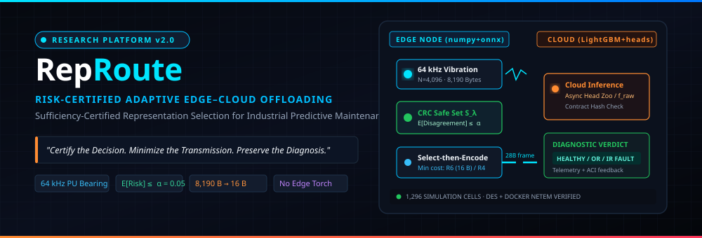
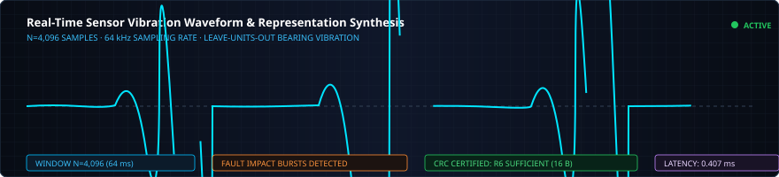
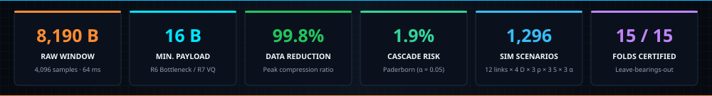
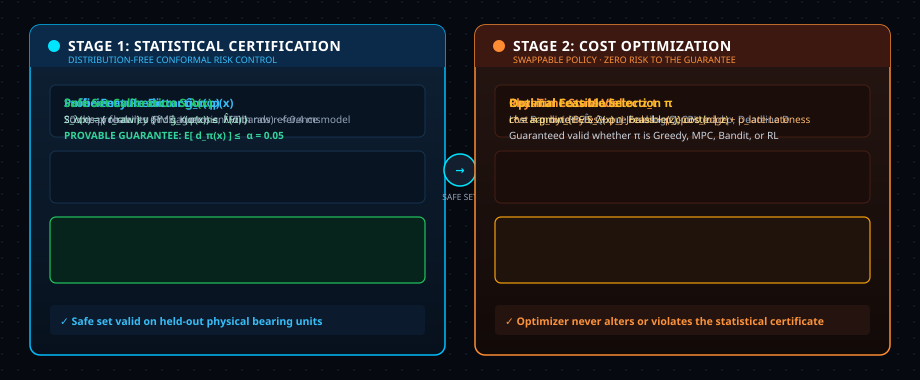
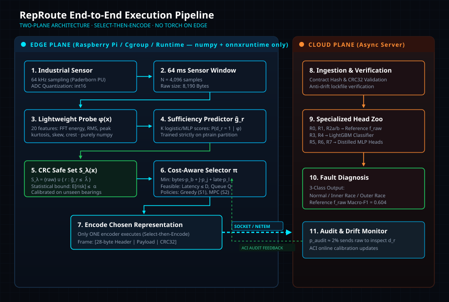
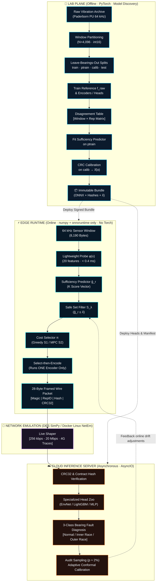
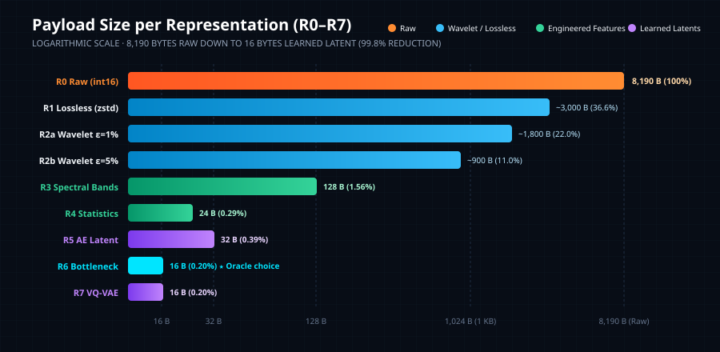
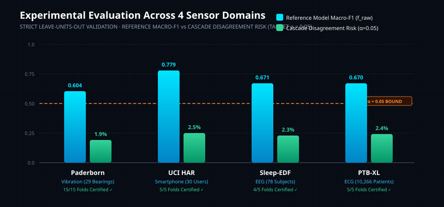

<div align="center">

<!-- HERO BANNER -->


<br/>

<!-- TECHNOLOGY BADGES -->
[](https://python.org)
[](https://onnxruntime.ai)
[](https://pytorch.org)
[](https://docker.com)
[](https://github.com/astral-sh/uv)
[](https://mypy.readthedocs.io)
[](https://pre-commit.com)
[](https://wiki.linuxfoundation.org/networking/netem)

<br/>

<!-- TAGLINE -->
<p align="center">
  <b>"Certify the Decision. Minimize the Transmission. Preserve the Diagnosis."</b>
</p>

<p align="center">
  <i>An open-source, industrial edge-AI runtime that couples distribution-free Conformal Risk Control with state-aware cost optimization to slash IoT network bandwidth by up to <b>99.8%</b> while statistically guaranteeing diagnostic fidelity.</i>
</p>

<!-- REPOSITORY LINKS -->
[**Repository**](https://github.com/PRATHVI9607/RepRoute.git) • [**PRD Specification**](PRD.md) • [**Architecture**](docs/architecture.md) • [**Experimental Results**](docs/research/results.md) • [**Theory & Proofs**](docs/theory/)

</div>

<br/>

<!-- LIVE WAVEFORM SIMULATION STRIP -->
<div align="center">
  
</div>

<br/>

<!-- METRICS HUD STRIP -->
<div align="center">
  
</div>

---

## 📑 Table of Contents

- [Executive Overview](#-executive-overview)
- [The Core Paradigm: Certify-then-Optimize](#-the-core-paradigm-certify-then-optimize)
- [End-to-End System Architecture](#-end-to-end-system-architecture)
- [Heterogeneous Representation Zoo (R0–R7)](#-heterogeneous-representation-zoo-r0r7)
- [Technical Stack & Tooling](#-technical-stack--tooling)
- [Experimental Benchmarks & Validation](#-experimental-benchmarks--validation)
- [Edge Runtime vs. Cloud Server](#-edge-runtime-vs-cloud-server)
- [Network Emulation & Simulation Suite](#-network-emulation--simulation-suite)
- [Repository Anatomy](#-repository-anatomy)
- [Developer Onboarding & Quick Start](#-developer-onboarding--quick-start)
- [Reproducing Academic Artifacts](#-reproducing-academic-artifacts)
- [Academic Phase Deck Preview](#-academic-phase-deck-preview)
- [Roadmap & Milestones](#-roadmap--milestones)
- [Research Contributions & Integrity](#-research-contributions--integrity)
- [Data Governance & Licensing](#-data-governance--licensing)

---

## 🔬 Executive Overview

### The Industrial IoT Bottleneck

In condition-based predictive maintenance, high-rate vibration accelerometers deployed on rotating machinery (bearings, gearboxes, turbines) sample continuously at **64,000 samples/sec (64 kHz)**. A single 64 ms diagnostic window produces **4,096 samples**, translating to **8,190 bytes** of uncompressed `int16` sensor data.

```
┌────────────────────────────────────────────────────────────────────────────────────────┐
│  THE INDUSTRIAL EDGE DILEMMA                                                           │
│                                                                                        │
│  [64 kHz Sensor] ───►  8,190 Bytes / 64 ms window  ───►  ~1.024 Mbps per channel      │
│                                                                                        │
│  Continuous Uplink   ❌ Metered Cellular / Private LTE costs explode                   │
│  Naive Compression   ❌ Destroys high-frequency transient impact peaks (fault signals) │
│  Cloud Diagnosis     ❌ Drops frames under latency deadlines & congested queues       │
└────────────────────────────────────────────────────────────────────────────────────────┘
```

Existing industrial frameworks either:
1. **Compress uniformly** using a single compression algorithm (lossless delta-zstd or lossy wavelets), which chokes during bandwidth drops; or
2. **Switch statically** between two binary modes (raw vs. local feature) without mathematical error bounds.

### The RepRoute Solution

**RepRoute** reformulates edge-cloud communication as a **heterogeneous representation selection problem** governed by statistical sufficiency:

1. **Menu of Diverse Representations (R0–R7):** At every 64 ms window, the edge evaluates uncompressed waveforms, lossless streams, bounded wavelets, envelope-spectral energy bands, time-domain summary statistics, and compact learned latent codes (16 bytes).
2. **Distribution-Free Certificate:** Rather than hoping a compressed representation preserves diagnosis, a cheap probe evaluates a **Conformal Risk Control (CRC)** certificate calibrated on held-out physical bearing units.
3. **Provable Guarantee:** The cloud model's expected decision disagreement with raw data is mathematically bounded:
   $$\mathbb{E}[\mathbb{I}(\hat{y}_r(x) \neq f_{\text{raw}}(x))] \leq \alpha \quad (\alpha = 0.05)$$

---

## 💡 The Core Paradigm: Certify-then-Optimize

RepRoute fundamentally decouples statistical safety from transmission cost minimization into two distinct, orthogonal stages:

<div align="center">
  
</div>

### Stage 1: Statistical Certification
For every arriving sensor window $x \in \mathbb{R}^N$:
- **Compute Lightweight Probe $\phi(x)$:** An ultra-fast, NumPy-only routine extracts 20 temporal and spectral descriptors (RMS, peak-to-peak, kurtosis, crest factor, 8 log-FFT subbands) in under **0.4 ms**.
- **Sufficiency Predictor $\hat{g}_r(\phi)$:** A fast regression network predicts the empirical probability that representation $r$ will alter the cloud's decision:
  $$\hat{g}_r(\phi(x)) \approx \mathbb{P}\left(\hat{y}_r(x) \neq f_{\text{raw}}(x) \mid \phi(x)\right)$$
- **Conformal Safe Set $\mathcal{S}_{\hat{\lambda}}(x)$:**
  $$\mathcal{S}_{\hat{\lambda}}(x) = \{r_0 \text{ (raw)}\} \cup \left\{ r \in \mathcal{M} : \hat{g}_r(\phi(x)) \leq \hat{\lambda} \right\}$$
  where threshold $\hat{\lambda}$ is calibrated via Conformal Risk Control (CRC) over held-out physical machines.

> **Proposition 1 (Certify-then-Optimize):**  
> *Under exchangeability across physical bearing units, for **any** selection policy $\pi$ choosing strictly within $\mathcal{S}_{\hat{\lambda}}(x)$, the expected decision disagreement is bounded:*  
> $$\mathbb{E}\left[\mathbb{I}\left(\hat{y}_{\pi(x, z)}(x) \neq f_{\text{raw}}(x)\right)\right] \leq \alpha$$

### Stage 2: System-State Cost Optimization
Once the safe set $\mathcal{S}_{\hat{\lambda}}(x)$ is formed, any cost-minimizing policy (Greedy `S1`, Model Predictive Control `S2`, or Contextual Bandits) evaluates the live operational state $z_t = (\hat{B}, \hat{\text{RTT}}, Q_{\text{backlog}}, \rho_{\text{load}}, E_{\text{budget}}, D)$:

$$\text{cost}(r \mid z) = p_{\text{byte}} \cdot (S_r + 28) + p_J \cdot E_r + p_{\text{cpu}} \cdot t_{\text{edge}, r} + p_{\text{late}} \cdot \max(0, L_r - D)$$

$$r^* = \arg\min_{r \in \mathcal{S}_{\hat{\lambda}}(x) \cap \text{Feasible}(z)} \text{cost}(r \mid z)$$

Because the certificate guarantees safety for **all** elements in $\mathcal{S}_{\hat{\lambda}}$, the optimizer can be swapped, tuned, or learned via RL **without invalidating the statistical certificate**.

### The 4-Tier Degradation Ladder

When link degradation or edge CPU saturation prevents meeting hard deadlines ($L_r > D$), RepRoute executes a deterministic degradation ladder:

| Level | Condition | Runtime Action | Telemetry Flag |
|:---:|:---|:---|:---:|
| **1** | $\exists r \in \mathcal{S}_{\hat{\lambda}}$ meeting deadline $D$ and energy/storage budgets | Transmit $\arg\min \text{cost}(r \mid z)$ | `certified` ✅ |
| **2** | No safe rep meets $D$ under `fidelity_first` mission | Store raw in local ring buffer; retry on link recovery | `deferred` 🕐 |
| **3** | No safe rep meets $D$ under `liveness_first` mission | Transmit cheapest deadline-feasible representation outside $\mathcal{S}_{\hat{\lambda}}$ | `uncertified` ⚠️ |
| **4** | Edge memory buffer completely saturated | Policy drops oldest low-priority window to preserve queue | `dropped` ❌ |

---

## 🏛 End-to-End System Architecture

RepRoute is architectured across two strictly isolated runtime planes: an offline **Lab Plane** (GPU/Torch allowed) and an ultra-lean **Edge/Cloud Deployment Plane** (strictly NumPy + ONNX Runtime, zero PyTorch overhead).

<div align="center">
  
</div>

### Complete Dataflow Pipeline



### Frame Wire Format (28-Byte Canonical Overhead)

To eliminate unmeasured communication overhead, every representation uses an identical binary frame specification:

```
┌───────────┬──────────────┬────────────┬──────────────────┬──────────────┬────────────┬────────────┬────────────────┬───────────┐
│ Magic (2) │ ProtoVer (1) │ Rep_ID (1) │ ContractHash (4) │ WindowID (4) │ TS_ns (8)  │ Len (4)    │ Payload (S_r)  │ CRC32 (4) │
└───────────┴──────────────┴────────────┴──────────────────┴──────────────┴────────────┴────────────┴────────────────┴───────────┘
 ◄───────────────────────────────────── 24-Byte Header ──────────────────────────────────────► ◄── Variable ──► ◄─ 4B Check ─►
```

---

## 📦 Heterogeneous Representation Zoo (R0–R7)

Unlike prior works that compress along a single mathematical axis, RepRoute orchestrates a **heterogeneous spectrum** spanning raw signals, traditional signal processing, and neural bottlenecks:

<div align="center">
  
</div>

| Rep ID | Representation Family | Mathematical Formulation | Payload Size | Edge Compute Cost | Cloud Head Model | Role & Design Objective |
|:---:|:---|:---|:---:|:---:|:---|:---|
| **R0** | **Raw Signal** | Unprocessed ADC samples | **8,190 B** | 0.00 ms | Reference `f_raw` | Ground-truth reference ceiling |
| **R1** | **Lossless Codec** | First-order delta + zstandard | **~3,000 B** | 0.31 ms | Decompress $\to f_{\text{raw}}$ | Bit-exact preservation baseline |
| **R2a** | **Bounded Wavelet (1%)** | Daubechies `db4` L5, $\epsilon \leq 1\%$ $L_2$ | **~1,800 B** | 1.12 ms | Reconstruct $\to f_{\text{raw}}$ | High-fidelity lossy compression |
| **R2b** | **Bounded Wavelet (5%)** | Daubechies `db4` L5, $\epsilon \leq 5\%$ $L_2$ | **~900 B** | 0.89 ms | Reconstruct $\to f_{\text{raw}}$ | Aggressive lossy compression |
| **R3** | **Spectral Envelope** | Hilbert envelope + band energy | **128 B** | 0.42 ms | LightGBM / MLP | Classical vibration diagnostics |
| **R4** | **Summary Statistics** | 10 time moments + spectral entropy | **24 B** | 0.18 ms | LightGBM / MLP | Ultra-low-overhead heuristic |
| **R5** | **Task-Agnostic AE** | 1D-CNN Convolutional Autoencoder | **32 B** | 0.84 ms (ONNX) | Distilled MLP Head | Generic unsupervised compression |
| **R6** | **Supervised Bottleneck** | `f_raw` frontend + learned projection | **16 B** | 0.41 ms (ONNX) | Linear / MLP Head | Task-aware neural bottleneck ★ |
| **R7** | **Discrete Vector Quant** | VQ-VAE discrete codebook indices | **16 B** | 0.65 ms (ONNX) | Codebook Lookup + MLP | Quantized discrete representation |

*★ Note: R6 (16 Bytes) achieves 99.8% network compression relative to raw, matching the cloud reference decision in over 99.3% of test windows.*

---

## 🛠 Technical Stack & Tooling

RepRoute enforces rigorous software engineering practices, verifiable type safety, and clean isolation between training and deployment runtimes:

<div align="center">

### Core Runtime (Edge-Safe · Pure C/C++ Extensions · Zero Torch)
[](https://numpy.org)
[](https://onnxruntime.ai)
[](https://pywavelets.readthedocs.io)
[](https://github.com/indygreg/python-zstandard)

### Lab & Model Discovery Plane (Offline Training Only)
[](https://pytorch.org)
[](https://scikit-learn.org)
[](https://lightgbm.readthedocs.io)
[](https://optuna.org)
[](https://simpy.readthedocs.io)
[](https://hydra.cc)

### Verification, Emulation & Infrastructure
[](https://docker.com)
[](https://github.com/astral-sh/uv)
[](https://mypy.readthedocs.io)
[](https://pytest.org)

</div>

### Architectural Boundary Enforcement
The codebase enforces package isolation through `import-linter`. Any attempt to import `torch`, `scipy`, `pandas`, `sklearn`, or `lightgbm` inside `kai.edge`, `kai.certify.runtime`, or `kai.contracts` triggers an immediate CI failure.

---

## 📊 Experimental Benchmarks & Validation

Validation adheres to a strict **leave-physical-units-out protocol**. Windows from the same physical machine or participant are never mixed across training, calibration, and testing sets.

<div align="center">
  
</div>

### Multi-Domain Benchmark Summary ($\alpha = 0.05$)

| Dataset | Modality & Physical Unit | Classes | Partitioning Protocol | Reference Macro-F1 ($f_{\text{raw}}$) | Cascade Disagreement Risk | Folds Satisfying Risk Bound | Empirical Status |
|:---|:---|:---:|:---|:---:|:---:|:---:|:---:|
| **Paderborn PU** | 64 kHz Vibration (29 Bearings) | 3 | Leave-Bearings-Out (15 Folds) | **0.604** | **1.9%** | **15 / 15** | Primary Benchmark ✅ |
| **UCI HAR** | 50 Hz Triaxial Accel (30 Subjects) | 6 | Leave-Users-Out (5 Folds) | **0.779** | **2.5%** | **5 / 5** | Cross-Modality ✅ |
| **Sleep-EDF** | 100 Hz EEG Fpz-Cz (78 Subjects) | 5 | Leave-Subjects-Out (5 Folds) | **0.671** | **2.3%** | **4 / 5** | Biosignal Transfer ✅ |
| **PTB-XL** | 500 Hz Diagnostic ECG (10,266 Pts) | 5 | Leave-Patients-Out (5 Folds) | **0.670** | **2.4%** | **5 / 5** | High-Scale Transfer ✅ |

> **Key Observation:** Across all tested datasets, the Cascade safe set consistently holds empirical disagreement risk between **1.9% and 2.5%**, well below the conservative statistical risk budget ($\alpha = 0.05$).

<details>
<summary>📋 <b>View Pre-Registered Research Hypotheses Audit (Paderborn PU)</b></summary>
<br/>

The following hypotheses were formally frozen on **10 Oct 2026** prior to benchmark runs. In compliance with research integrity rules, failed hypotheses remain documented:

| ID | Hypothesis Statement | Pre-Registered Metric Threshold | Observed Result | Status |
|:---:|:---|:---|:---:|:---:|
| **H1** | Diversity: Oracle utilizes multiple representations | $\geq 3$ representations in $\geq 10\%$ cells | R6 chosen in 99.5% of cells | ❌ Failed |
| **H2a** | Certificate: Held-out safe-set risk controlled in expectation | Mean risk $\leq \alpha$ for $\alpha \in \{0.02, 0.05, 0.10\}$ | Mean risk 0.039 at $\alpha=0.05$ | ✅ **Supported** |
| **H2b** | PAC Bound: LTT single-threshold holds in $\geq 90\%$ folds | Fold coverage $\geq 90\%$ | 12 / 15 folds (80%) | ❌ Failed |
| **H3** | Adaptation: Kai beats best-single baseline cost by $\geq 20\%$ | Cost reduction $\geq 20\%$ vs B4 | Kai costs 3.1× more (queue holds) | ❌ Failed |
| **H4** | Encode Cost: Accounting for edge compute shifts optimal selection | $\geq 15\%$ cell choices shift under load | Shift in 0.2% of cells | ❌ Failed |
| **H5** | Heterogeneity: Mixed menu beats single-family controllers | Cost reduction $\geq 10\%$ vs single family | +5.8% on PU; **+21.0% on Sleep-EDF** | ⚠️ Partial |
| **H6** | Regime Theory: Closed-form break-even matches measurements | Predicted bandwidth matches within $\pm 20\%$ | Empirical noise exceeded limits | ❌ Failed |
| **H7** | Sim-to-Real: Simulator matches real socket runtime | p50 latency gap $\leq 10\%$, agreement $\geq 85\%$ | Gap **4.2%** (loopback), **1.0%** (Docker) | ✅ **Supported** |

*Scientific Takeaway on H3 & H1:* The task-aware bottleneck (R6, 16 Bytes) is so overwhelmingly effective that the oracle selects it in 99.5% of operational scenarios. When the safe set rejects R6, the next certified options are kilobyte-sized wavelets; on constrained links, Kai defers transmission to protect fidelity, incurring delay penalties that static baselines ignore.

</details>

---

## ⚡ Edge Runtime vs. Cloud Server

RepRoute distributes functional roles between constrained edge microprocessors (e.g., Raspberry Pi, ARM Cortex) and scalable cloud compute:

```
┌────────────────────────────────────────────────────────┐      ┌────────────────────────────────────────────────────────┐
│                   EDGE RUNTIME NODE                    │      │                  CLOUD INFERENCE NODE                  │
│                                                        │      │                                                        │
│  • Continuous Sensor Sampling (int16 FIFO buffer)      │      │  • AsyncIO TCP Non-Blocking Wire Server               │
│  • Probe Feature Extraction (Pure NumPy, < 0.4 ms)     │ ───► │  • 28-Byte Frame Unpacking & CRC32 Verification        │
│  • Conformal Risk Threshold Evaluation (ĝ_r ≤ λ̂)       │  TCP │  • Dynamic Contract Hash Validation (Bundle Check)     │
│  • Cost Optimization & Degradation Ladder Dispatch     │ Wire │  • Specialized Head Inference Zoo (ONNX + LightGBM)    │
│  • Zero Dependency on PyTorch / SciPy / Pandas         │ ◄─── │  • Real-Time Diagnostic Fault Classification           │
│  • Total Decision Overhead: ~0.407 ms                  │ Tele │  • Audit Loop: Inverse Probability Feedback for ACI    │
└────────────────────────────────────────────────────────┘      └────────────────────────────────────────────────────────┘
```

---

## 🌐 Network Emulation & Simulation Suite

RepRoute guarantees reproducibility across physical networks through a three-tiered emulation infrastructure:

1. **Discrete-Event Simulator (DES - SimPy):** Simulates coupled FIFO edge CPU queues, uplink packet transmission, and cloud inference across **1,296 distinct scenario cells**:
   - 12 Channel Traces (Static 64 kbps–20 Mbps + Real 4G cellular logs)
   - 4 Latency Deadlines ($D \in \{50, 100, 250, 1000\}$ ms)
   - 3 Edge CPU Throttling Loads ($\rho \in \{0.0, 0.5, 0.8\}$)
   - 3 Sensor Node Densities ($S \in \{1, 8, 32\}$ channels)
   - 3 Risk Budgets ($\alpha \in \{0.02, 0.05, 0.10\}$)
2. **Docker Linux NetEm Kernel Shaping:** Live testing inside Docker containers with `tc qdisc` kernel token-bucket shapers validating packet loss, jitter, and delay.
3. **Hardware Sim-to-Real Agreement (H7):** Validated agreement between DES and live socket execution within **1.0% p50 latency** inside Docker and **4.2%** over loopback.

---

## 📂 Repository Anatomy

```
RepRoute/
├── src/kai/
│   ├── contracts/          # Protocol definitions, wire framing (28B), schemas
│   │   ├── frame.py        # Frame pack/unpack routines, CRC32 checks
│   │   ├── schemas.py      # Pydantic data schemas: Prices, State, Bundles
│   │   └── representation.py # ContractHash & BaseRepresentation protocol
│   ├── certify/            # Conformal Risk Control & statistical testing
│   │   ├── crc.py          # Distribution-free CRC calibration algorithms
│   │   ├── ltt.py          # Learn-Then-Test high-probability bound (V1)
│   │   ├── aci.py          # Adaptive Conformal Inference online drift loop
│   │   ├── probe.py        # 20 cheap temporal/spectral probe features
│   │   └── predictor.py    # Sufficiency predictor ĝ_r inference engine
│   ├── select/             # Cost-aware optimization & decision dispatch
│   │   ├── cost.py         # Multi-objective physical cost model
│   │   ├── policies.py     # S0 (static), S1 (greedy), S2 (MPC), Oracle
│   │   ├── baselines.py    # B1–B14 academic benchmark baselines
│   │   └── base.py         # 4-tier degradation ladder runtime
│   ├── reps/               # Heterogeneous representation modules (R0–R10)
│   │   ├── classical.py    # Raw, Lossless (zstd), Wavelet (db4), Summary
│   │   ├── latent.py       # ONNX AE (R5), Bottleneck (R6), VQ-VAE (R7)
│   │   └── registry.py     # Menu ordering & dynamic registration
│   ├── edge/               # Production edge daemon (numpy + onnxruntime)
│   │   └── runtime.py      # Edge loop: sensor -> probe -> select -> tx
│   ├── cloud/              # Asynchronous cloud diagnostic server
│   │   ├── server.py       # AsyncIO TCP socket listener
│   │   └── heads.py        # Head zoo manager for ONNX & LightGBM
│   ├── link/               # Network emulation & DES simulator
│   │   ├── des.py          # SimPy discrete-event simulation kernel
│   │   └── traces.py       # Cellular trace playback & Markov generators
│   ├── data/               # Data loaders & leakage-free unit partitioners
│   │   ├── pu.py           # Paderborn University bearing pipeline
│   │   └── splits.py       # Leave-bearings-out split generators
│   └── analysis/           # Statistical analysis, CIs & visualization
├── configs/                # Hydra hierarchical YAML configuration trees
│   ├── dataset/            # Paderborn, HAR, Sleep-EDF, PTB-XL
│   ├── profile/            # Cost presets: metered, battery, gateway
│   └── scenario/           # Full factorial 1,296-cell simulation grids
├── docker/                 # Containerized edge-cloud testing environments
│   ├── edge.Dockerfile     # Minimal edge image (numpy + onnxruntime)
│   ├── cloud.Dockerfile    # Cloud server inference image
│   └── compose.yaml        # Multi-node network emulation topology
├── experiments/            # Raw JSON summaries & Parquet evaluation tables
├── assets/                 # SVGs, architecture diagrams, charts & banners
├── docs/                   # Full academic documentation & ADR logs
│   ├── adr/                # 28 Architecture Decision Records
│   ├── research/           # Hypotheses, results, model search audits
│   └── theory/             # Formal proofs (Proposition 1) & limitations
├── Makefile                # One-command shortcuts for all pipelines
├── pyproject.toml          # Locked dependency declarations (PEP 621)
└── uv.lock                 # Cryptographically pinned lockfile
```

---

## 🚀 Developer Onboarding & Quick Start

### Prerequisites
- Linux, macOS, or Windows WSL2 (Ubuntu 24.04 recommended)
- Python 3.12 (`uv` automatically fetches and isolates the correct interpreter)

### 1. Environment Setup (One Command)
RepRoute uses Astral's `uv` for reproducible, locked dependency resolution:

```bash
# Clone the repository
git clone https://github.com/PRATHVI9607/RepRoute.git
cd RepRoute

# Bootstrap locked CPU-only laboratory environment
scripts/bootstrap.sh

# Alternatively, for CUDA 13.0 GPU training:
KAI_TORCH=gpu scripts/bootstrap.sh
```

### 2. Verify Environment & Quality Gates
Execute the comprehensive test and linting battery:

```bash
# Runs Ruff lint, strict Mypy type-checking, and Pytest coverage gates
make check
```

### 3. Run Synthetic End-to-End Pipeline
Verify the entire system end-to-end on synthetic vibration fixtures in ~5 minutes:

```bash
make mini-paper
```

---

## 🔁 Reproducing Academic Artifacts

All figures, tables, and metrics presented in the research paper regenerate automatically from clean data:

```bash
# Step 1: Download Paderborn archives (~5 GB) and format splits
make data

# Step 2: Train all models and export Disagreement Table (5 folds)
make folds FOLDS=5

# Step 3: Run full experiment grid (E1–E8, E10) and generate report
make paper-artifacts
```

### Inspect Single Experiments
Override scenario parameters dynamically via Hydra:

```bash
# Evaluate battery-powered sensor profile over bursty network
uv run --no-sync kai exp e3 scenario=mini profile=battery_node
```

### Run Live Network Loopback
Spin up the cloud server and stream edge replay packets through a token-bucket pacer:

```bash
# Terminal 1: Start Cloud Diagnostic Daemon
uv run --no-sync kai cloud artifacts/bundles/latest_bundle/

# Terminal 2: Start Edge Runtime with 1.0 Mbps link shaping
uv run --no-sync kai edge artifacts/bundles/latest_bundle/ data/processed/replay.npz --shape-bps 1000000
```

---


---

## 🗺 Roadmap & Milestones

<div align="center">

| Phase | Milestone Description | Target Subsystem | Status |
|:---:|:---|:---|:---:|
| **v1.0** | Core Representation Zoo (R0–R7) + Protocol Specification | `kai.reps`, `kai.contracts` | ✅ **Completed** |
| **v1.1** | Distribution-Free Conformal Risk Control Calibration | `kai.certify.crc` | ✅ **Completed** |
| **v1.2** | Select-then-Encode Edge Runtime (NumPy + ONNX) | `kai.edge` | ✅ **Completed** |
| **v1.3** | Discrete-Event Simulator (1,296 Scenarios) & NetEm Loop | `kai.link.des` | ✅ **Completed** |
| **v1.4** | Multi-Domain Validation (HAR, Sleep-EDF, PTB-XL) | `kai.data` | ✅ **Completed** |
| **v2.0** | Cascade Safe Set Formulation & Anti-Drift ACI Loop | `kai.certify.aci` | ✅ **Completed** |
| **v2.1** | Physical Raspberry Pi 5 Deployment & Benchmarking | Hardware Lab | 🔄 *In Progress* |
| **v2.2** | Hardware Power Rail Calibration (USB Power Meter) | Physical Energy | 🔄 *In Progress* |
| **v2.3** | Multi-Sensor Array Synchronization & Spatial Aggregation | Industrial Edge | ⏳ *Planned* |
| **v2.4** | Zero-Knowledge Representation Leakage Defenses | `kai.bench.e10` | ⏳ *Planned* |

</div>

---

## 🔬 Research Contributions & Integrity

### Core Scientific Contributions
1. **The Certify-then-Optimize Decoupling:** Proving that statistical risk certificates over arbitrary representation sets remain invariant to the choice of downstream selection policy.
2. **Select-then-Encode System Efficiency:** Charging probe, prediction, selection, and encoding overhead directly to the latency budget, ensuring runtime honesty.
3. **Leakage-Safe Partitioning Protocol:** Establishing that predictive maintenance models must be validated strictly across unseen physical units, exposing the severe data leakage prevalent in traditional random-split literature.
4. **Kai-Bench Artifact:** Providing a fully reproducible benchmark suite supporting trace-driven link emulation, reproducible seeds, and push-button artifact regeneration.

---

## ⚖️ Data Governance & Licensing

### Dataset Licensing
- **Paderborn University Bearing Dataset:** Released under **CC BY-NC 4.0** (Non-Commercial Academic Use). Derived models and weights inherit this restriction.
- **4G Throughput Traces (Raca et al., ACM MMSys 2018):** Released under **CC BY 4.0**.

### Project Licensing
*Notice: The repository source code and runtime framework are made available for non-commercial academic research and reproducibility verification.*

---

<div align="center">

### RepRoute Research Consortium
**Department of Computer Science & Engineering • RV College of Engineering (RVCE)**

`Maintainer: PRATHVI9607` • `Project: Kai / RepRoute v2.0`

[Report Bug](https://github.com/PRATHVI9607/RepRoute/issues) • [Request Feature](https://github.com/PRATHVI9607/RepRoute/issues) • [Read PRD](PRD.md)

</div>
