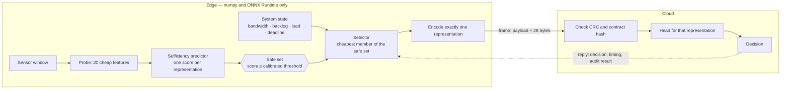
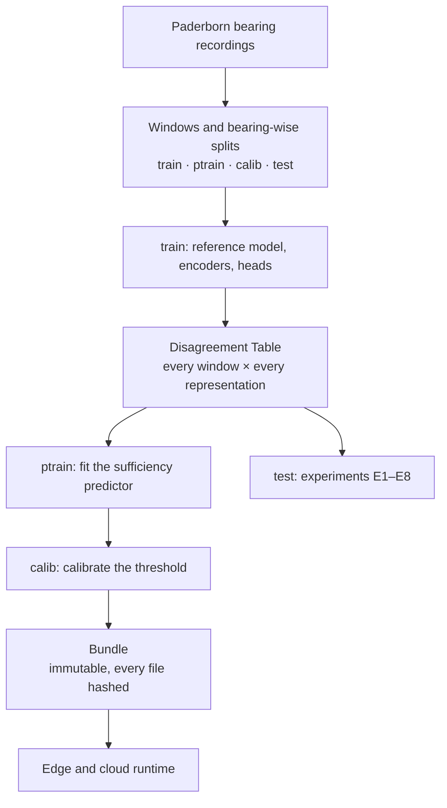
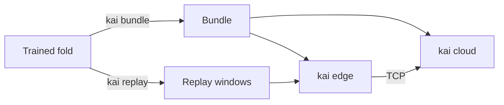

# Kai

**Sufficiency-certified representation selection for edge–cloud industrial IoT.**

An edge node has to decide, for every sensor window, *what* to send: raw samples, a compressed
waveform, engineered features, or a learned latent. Kai makes that a two-step decision:

1. **Certify** — score how likely each representation is to make the cloud disagree with the
   decision it would have made from raw data, and keep only a **safe set** calibrated so that
   `E[disagreement with the raw decision] ≤ α`.
2. **Optimize** — let any cost-aware policy pick the cheapest representation **inside that set**
   for the current bandwidth, backlog, edge load and deadline.

The guarantee holds for every member of the safe set, so the optimizer can be swapped without
re-proving anything. [PRD.md](PRD.md) is the full specification.

## How it works



Everything the edge needs comes from one offline pipeline:



No bearing appears in two partitions, so the models, the predictor, the calibration and the
evaluation each see different physical machines.

## Status

Three passes done (implementation; reference model and certificate review; simulator, audit and replication). Results are in [docs/research/results.md](docs/research/results.md), generated by
`make report` and never edited by hand.

| | |
|---|---|
| **Built and tested** | Representations R0–R7, opt-in mid-size wavelets and R10 log-mel · certificate variants V0 / V1 / V2, the static set, the cascade and group CRC · ACI and drift monitor · selectors S0 / S1 / S2 and the oracle · baselines B1–B5, B8–B11 and B13 · discrete-event simulator · edge and cloud runtime over real sockets · Docker closed loop with `tc netem` · experiments E1–E8 and the privacy probe E10 · a recorded reference-model search |
| **Ready, not yet run** | Raspberry Pi edge (`scripts/pi_setup.sh`) |
| **Not built** | R8 (JEPA), R9 (MiniRocket), bandit and RL selectors, escalation, the paper (draft only), SHHS (access pending) |
| **Modelled, not measured** | All energy numbers · the "slow edge" sensitivity run · the 3G / 4G / 5G traces (synthetic) |

## What the results say

Eight datasets, all evaluated leave-units-out. Four were rerun on 2026-11-01 after a full code
review (ADR 0020, ADR 0021): **Paderborn** bearings (15 folds, the main study), **UCI HAR**,
**Speech Commands** (also with an exploratory log-mel menu, ADR 0018) and **Sleep-EDF** (5 folds
each). HUST, UORED and PTB-XL are from earlier code and were not rerun. The hypotheses were fixed
before the experiments ([docs/research/hypotheses.md](docs/research/hypotheses.md)); a tested
hypothesis counts as *supported* only if its threshold is met **and** a Holm test over all eight
rejects (within each dataset, not across datasets). Full numbers: [results.md](docs/research/results.md)
(Paderborn), [results-har.md](docs/research/results-har.md),
[results-speechcmd.md](docs/research/results-speechcmd.md),
[results-speechcmd-logmel.md](docs/research/results-speechcmd-logmel.md),
[results-sleepedf.md](docs/research/results-sleepedf.md), [results-hust.md](docs/research/results-hust.md),
[results-uored.md](docs/research/results-uored.md), [results-ptbxl.md](docs/research/results-ptbxl.md).
What changed and why: [updates.md](updates.md) §6.

Risk is disagreement with the cloud model's raw-data decision at α = 0.05: mean over folds; folds within α.

| Dataset | Units | Cloud model, macro-F1 on unseen units | Per-window certificate (V0) | Certified static set (exploratory) | **Cascade** (exploratory) | **H5** mixed menu beats the best single family |
|---|---|---|---|---|---|---|
| Paderborn | 29 bearings | 0.60 | 0.039; 12/15 | 0.030; 15/15 | **0.019; 15/15** | +5.8 % |
| UCI HAR | 30 users | 0.78 | 0.049; 3/5 | 0.000; 5/5 | **0.025; 5/5** | +10.9 %, n.s. |
| Speech Commands | 2 492 speakers | 0.92 | 0.052; 2/5 | 0.029; 5/5 | **0.027; 5/5** | +5.0 % |
| Speech Commands + log-mel (exploratory) | 2 492 speakers | 0.92 | 0.052; 2/5 | 0.029; 5/5 | **0.027; 5/5** | +15.9 %, supported (not confirmatory) |
| Sleep-EDF | 78 subjects | 0.67 | 0.041; 4/5 | 0.041; 5/5 | **0.023; 4/5** | **+21.0 %, supported** |
| HUST (earlier code) | 15 bearings | 0.64 | 0.078; 2/5 | 0.027; 4/5 | not run | +15.1 %, n.s. |
| UORED (earlier code) | 20 bearings | 0.75 | 0.079; 2/5 | 0.017; 5/5 | 0.059; 2/5 | +15.2 %, n.s. |
| PTB-XL (earlier code) | 10 266 patients | 0.67 | 0.049; 4/5 | 0.032; 5/5 | 0.024; 5/5 | +15.9 %, supported |

Three patterns. The **cascade's and the static set's mean risk is below α** on every rerun dataset
(cascade 0.019–0.027 at α = 0.05; descriptively 29 of 30 folds within α). The bound is on the
expected risk only, and the margin is the slack of the cascade's α/2 + α/2 split. The
**per-window certificate depends on exchangeable calibration units**: on Speech Commands it lands
at 0.052 (CI [0.048, 0.055]), on α; on Paderborn it stays below α on average at every α; on HUST and
UORED (earlier code) and on HAR at α = 0.1 (0.104) bearing or user shift pushes it over. **H7's
descriptive threshold** (simulator vs real runtime) is met on three of four rerun datasets
(Paderborn 4.2 %, HAR 5.6 %, Sleep-EDF 6.1 %; Speech Commands fails at 12.5 %), with the log-mel
menu (8.8 %) and in Docker on Paderborn (1.0 %).

**H3 (adaptation pays) fails on every dataset.** On HAR Kai is 26 % cheaper than best-single but
misses the deadline-miss target. On Paderborn, Speech Commands and Sleep-EDF it costs more: when a
window's safe set excludes the cheap latent, the next certified options are KB-sized, they miss the
deadline on slow links, and Kai holds the window back, while best-single keeps sending the latent without a
certificate. (Best-single screens every representation with a marginal check on calibration data
and keeps the cheapest that passes; that bounds nothing once several are tried, ADR 0022.) Log-mel on Speech Commands (146 bytes, 11 % disagreement) meets H5 but not H3. A
group-level certificate (one sample per unit, ADR 0020, exploratory) needs at least 19 calibration
units at α = 0.05 and 9 at α = 0.1: Speech Commands has them at every α, Sleep-EDF only at α = 0.1.

**The cloud model.** Chosen from about 150 recorded candidates by cross-validation on training
bearings only ([ADR 0006](docs/adr/0006-envelope-reference-model.md),
[model-search.md](docs/research/model-search.md)).

| Reference model | Macro-F1 on unseen bearings | Fold range |
|---|---|---|
| Spectral-shape model (first pass) | 0.47 | 0.29–0.59 |
| **EnvNet: envelope spectrum over its own median + logistic regression** | **0.60** | 0.37–0.80 |
| … on the second dataset (HUST) | 0.64 | 0.40–0.86 |
| Majority class | 0.18 | — |

Scores near 0.95 on this dataset come from splits that put windows of the same bearing in training
and test; the same features drop from 0.95 to 0.48 when the bearing is new. Such splits are banned
here. Published results on unseen bearings lie between 0.33 and 0.75.

**The certificate.**

| | Paderborn, 15 folds | HUST, 5 folds |
|---|---|---|
| Per-window certificate (V0): risk at α = 0.02 / 0.05 / 0.10 | 0.012 / 0.039 / 0.079 — below α on average, within α in 13, 12, 12 of 15 folds; H2a not supported; non-inferiority at α + 0.01 rejects, p = 0.032 (ADR 0022, exploratory) | 0.043 / 0.078 / 0.127 — above α |
| **Certified static safe set** (same guarantee, no probe or predictor on the edge; exploratory) | 0.010 / 0.030 / 0.030 — within α in **every** fold, cheapest certified payload 0.2 % of raw | 0.008 / 0.027 / 0.060 — within α in 5, 4, 5 of 5 folds |

**The system** (Paderborn, scenario grid of 1 296 cells, bytes priced).

| | Result | Verdict |
|---|---|---|
| **H1** several representations matter | the oracle's main choice is one 16-byte latent in 99.5 % of cells | not supported |
| **H3** Kai beats the best single representation | cost **3.1 × higher** with the per-window certificate, 2.0 × with the cascade: it holds back 29 % of windows whose safe set excludes the latent, because nothing certified reaches the cloud in time. Deadline misses on bursty links **26 % lower** than the context-blind baseline (target 30 %) | not supported |
| Certified static safe set (exploratory) | 1.4 × the cost of best-single, with fewer deadline misses (13.9 % against 19.1 %) | — |
| When edge CPU time is priced (`wired_gateway`, exploratory, 15 folds) | with the CPU pinned to the `performance` profile (ADR 0014) the oracle uses R4 in 98 % of cells; per-window Kai costs **3.4× more** than best-single, the cascade 2.2× more. The earlier saving came from the slower `powersave` timings | adaptivity pays only when the edge is slow; on this laptop it is not |
| **H4** encode cost changes the choice | 0.2 % of loaded cells | not supported |
| **H5** a mixed menu beats one family | 5.8 % cheaper (target 10 %); supported on Sleep-EDF, PTB-XL and (exploratory) Speech Commands with log-mel | not supported |
| Queue awareness (ablation) | ignoring the uplink queue costs 30 % more | — |
| **H6** closed-form break-evens | re-measured: 1 of 10 measured boundaries matches, error 128 %; with crossings inside the measurement noise dropped (ADR 0022, exploratory) none is left on any of the four re-measured datasets | not supported |
| **H7** simulator matches the real runtime | same choice for 100 % of windows; p50 latency off by 4.2 % (loopback) and 1.0 % (Docker), target 10 % | threshold met (descriptive) |
| New operating condition (held out) | the any-policy risk rises to 0.13 at α = 0.05: the certificate does not survive a condition shift | — |
| Privacy probe (exploratory) | a 16-byte latent still re-identifies a known machine in 59 % of windows (chance 18 %) | compact is not private |

Before quoting any of this ([docs/theory/limitations.md](docs/theory/limitations.md)):

- The certificate controls agreement with the cloud model, not its correctness.
- The 16-byte latent agrees with the cloud model because the edge runs that model's feature
  extraction — close to classifying on the edge ([worksplit.md](worksplit.md), open decision).
- Results before 14 October evening simulated one healthy bearing per fold and must not be quoted
  ([ADR 0010](docs/adr/0010-code-audit-fixes.md)).

## Quick start

```bash
scripts/bootstrap.sh                  # uv, Python 3.12, locked environment with CPU torch, checks
KAI_TORCH=gpu scripts/bootstrap.sh    # the same with the CUDA 13.0 build of torch
make check                            # lint, types, import contracts, tests with coverage gates
make mini-paper                       # the whole pipeline on a synthetic dataset, about 5 minutes
```

The CPU and GPU builds of torch are separate, mutually exclusive extras
(`uv sync --extra lab --extra cpu` or `--extra gpu`). The edge never needs either.

## Reproduce the results

```bash
make data               # download 29 Paderborn archives (about 5 GB) and build the windows and splits
make folds FOLDS=5      # train per fold and build the Disagreement Table (about 10 min per fold on a laptop GPU)
make paper-artifacts    # experiments E1–E8 and E10, figures, docs/research/results.md
```

`KAI_WORK=/some/dir` moves `data/`, `artifacts/` and `experiments/` elsewhere. A single experiment
takes Hydra overrides: `uv run --no-sync kai exp e3 scenario=mini profile=battery_node`.

## Run the edge and the cloud



| Where | Command |
|---|---|
| One machine | `kai cloud <bundle>` in one terminal, `kai edge <bundle> <replay.npz> --shape-bps 1e6` in another |
| Docker, kernel-shaped link | `make docker-loop FOLD=<fold dir> BUNDLE=artifacts/bundles/<id>` — runs at 256 kbit/s, 1 Mbit/s and 5 Mbit/s and compares each run with the simulator |
| Raspberry Pi | `scripts/pi_setup.sh` on the Pi (edge-only install, no torch), then `kai edge` against a `kai cloud` on another machine. Re-run `kai exp e1` on the Pi first: the shipped timings are from a laptop |

## Repository map

| Path | Contents |
|---|---|
| `src/kai/contracts` | representation protocol, wire frame, schemas |
| `src/kai/data`, `reps`, `tasks` | dataset and splits · representations R0–R7 · models, heads and the fold pipeline |
| `src/kai/certify`, `select` | probe, predictor, calibration, ACI, drift · cost model, ladder, selectors, baselines |
| `src/kai/link`, `edge`, `cloud` | simulator and traces · edge runtime · cloud server |
| `src/kai/profile`, `bench`, `analysis` | timing harness · experiments and registry · regime theory, statistics, figures |
| `tests/` | unit, property, integration, end-to-end and the synthetic mini-paper |
| `configs/` | Hydra: dataset, price presets, scenario grids |
| `docker/`, `scripts/` | images and shaping · data download, environment check, report |

## Documentation

| | |
|---|---|
| [docs/architecture.md](docs/architecture.md) | planes, packages, wire protocol, how to add a representation |
| [docs/glossary.md](docs/glossary.md) | the vocabulary, used the same way everywhere |
| [docs/theory/](docs/theory/) | Proposition 1 with its proof · regime theory · limitations of the guarantee |
| [docs/adr/](docs/adr/) | decisions and why, including every departure from the PRD |
| [docs/research/](docs/research/) | pre-registered hypotheses · results · every reference-model candidate tried · baselines · novelty log |
| [worksplit.md](worksplit.md) | what each role does next, ranked by what the results showed |
| [CONTRIBUTING.md](CONTRIBUTING.md) | quality gates and the rules that are not negotiable |

## Data and licence

| Data | Source | Licence | In this repository |
|---|---|---|---|
| Paderborn bearing recordings | KAt-DataCenter, Paderborn University (Lessmeier et al., PHME 2016) — <https://mb.uni-paderborn.de/kat/forschung/bearing-datacenter/> | CC BY-NC 4.0: non-commercial academic use, citation required | downloaded by `make data`, never committed |
| 4G throughput traces | Raca et al., ACM MMSys 2018 — <https://zenodo.org/records/1219679> | CC BY 4.0 | downloaded by `make data`, never committed |

The Paderborn licence is **non-commercial**: anything trained on that data inherits the
restriction. This repository has **no licence file yet**: the project owner has to choose one, and
the choice must not promise more than the data allows.
