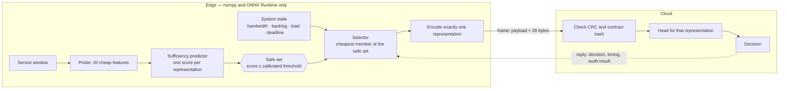
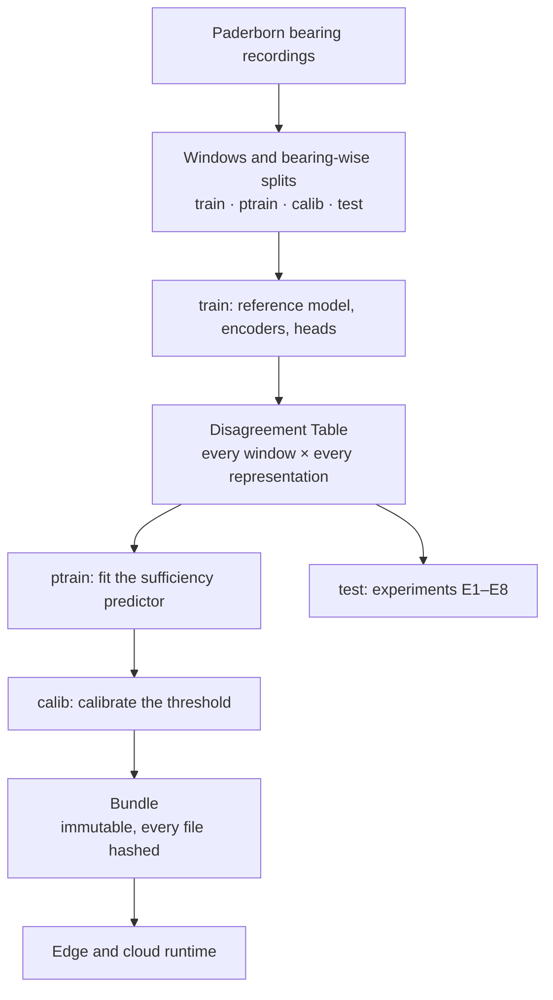
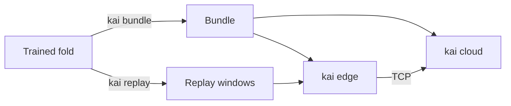

# Kai

**Sufficiency-certified representation selection for edge–cloud industrial IoT.**

An edge node has to decide, for every sensor window, *what* to send: raw samples, a compressed
waveform, engineered features, or a learned latent. Kai makes that a two-step decision:

1. **Certify** — score how likely each representation is to make the cloud disagree with the
   decision it would have made from raw data, and keep only a **safe set** calibrated so that
   `E[disagreement with the raw decision] ≤ α`.
2. **Optimize** — let any cost-aware policy pick the cheapest representation **inside that set**
   for the current bandwidth, backlog, edge load and deadline.

The guarantee holds for every member of the safe set, so the optimizer can be swapped without
re-proving anything. [PRD.md](PRD.md) is the full specification.

## How it works



Everything the edge needs comes from one offline pipeline:



No bearing appears in two partitions, so the models, the predictor, the calibration and the
evaluation each see different physical machines.

## Status

Three passes done (implementation; reference model and certificate review; simulator, audit and replication). Results are in [docs/research/results.md](docs/research/results.md), generated by
`make report` and never edited by hand.

| | |
|---|---|
| **Built and tested** | Representations R0–R7 · certificate variants V0 / V1 / V2 · ACI and drift monitor · selectors S0 / S1 / S2 and the oracle · baselines B1–B5 and B8–B11 · discrete-event simulator · edge and cloud runtime over real sockets · Docker closed loop with `tc netem` · experiments E1–E8 and the privacy probe E10 · a recorded reference-model search |
| **Ready, not yet run** | Raspberry Pi edge (`scripts/pi_setup.sh`) |
| **Not built** | R8 (JEPA), R9 (MiniRocket), bandit and RL selectors, escalation, transfer dataset, the paper |
| **Modelled, not measured** | All energy numbers · the "slow edge" sensitivity run · the 3G / 4G / 5G traces (synthetic) |

## What the results say

Four datasets, all evaluated leave-units-out: **Paderborn** bearings (15 folds, the main study),
**HUST** and **UORED** bearings (5 folds each), and **PTB-XL** ECG, where the unit is the patient
(10 266 patients, 5 folds). The hypotheses were fixed before the experiments
([docs/research/hypotheses.md](docs/research/hypotheses.md)); a tested hypothesis counts as
*supported* only if its threshold is met **and** a Holm test over all eight rejects. Full numbers:
[results.md](docs/research/results.md) (Paderborn), [results-hust.md](docs/research/results-hust.md),
[results-uored.md](docs/research/results-uored.md), [results-ptbxl.md](docs/research/results-ptbxl.md).

| | Paderborn | HUST | UORED | **PTB-XL** |
|---|---|---|---|---|
| Units | 29 bearings | 15 bearings | 20 bearings | **10 266 patients** |
| Cloud model, macro-F1 on unseen units | 0.60 | 0.64 | 0.75 | 0.67 |
| Per-window certificate (V0), risk at α = 0.05; folds within α | 0.039; 12/15 | 0.078; 2/5 | 0.079; 2/5 | **0.049; 4/5** |
| Certified static set, risk at α = 0.05; folds within α | 0.030; 15/15 | 0.027; 4/5 | 0.017; 5/5 | 0.032; 5/5 |
| Cascade, risk at α = 0.05; folds within α | 0.019; 15/15 | not run | 0.059; 2/5 | 0.024; 5/5 |
| **H5** mixed menu beats the best single family | 5.6 % | 15.1 %, n.s. | 15.2 %, n.s. | **15.9 %, supported** |

Two patterns hold across all four. The **certified static set keeps its bound everywhere**. The
**per-window certificate is exactly as good as its calibration units are exchangeable**: on
PTB-XL, with thousands of patients, it lands on α as the theory predicts; with a handful of
bearings it is pushed over α by bearing-to-bearing shift.

**The cloud model.** Chosen from about 150 recorded candidates by cross-validation on training
bearings only ([ADR 0006](docs/adr/0006-envelope-reference-model.md),
[model-search.md](docs/research/model-search.md)).

| Reference model | Macro-F1 on unseen bearings | Fold range |
|---|---|---|
| Spectral-shape model (first pass) | 0.47 | 0.29–0.59 |
| **EnvNet: envelope spectrum over its own median + logistic regression** | **0.60** | 0.37–0.80 |
| … on the second dataset (HUST) | 0.64 | 0.40–0.86 |
| Majority class | 0.18 | — |

Scores near 0.95 on this dataset come from splits that put windows of the same bearing in training
and test; the same features drop from 0.95 to 0.48 when the bearing is new. Such splits are banned
here. Published results on unseen bearings lie between 0.33 and 0.75.

**The certificate.**

| | Paderborn, 15 folds | HUST, 5 folds |
|---|---|---|
| Per-window certificate (V0): risk at α = 0.02 / 0.05 / 0.10 | 0.012 / 0.039 / 0.079 — below α on average, within α in 13, 12, 12 of 15 folds; not significantly below α (H2a: threshold met, not significant) | 0.043 / 0.078 / 0.127 — above α |
| **Certified static safe set** (same guarantee, no probe or predictor on the edge; exploratory) | 0.010 / 0.030 / 0.030 — within α in **every** fold, cheapest certified payload 0.2 % of raw | 0.008 / 0.027 / 0.060 — within α in 5, 4, 5 of 5 folds |

**The system** (Paderborn, scenario grid of 1 296 cells, bytes priced).

| | Result | Verdict |
|---|---|---|
| **H1** several representations matter | the oracle's main choice is one 16-byte latent in 99.5 % of cells | not supported |
| **H3** Kai beats the best single representation | cost **3.4 × higher** with the per-window certificate: it holds back about 30 % of windows whose safe set excludes the latent. Deadline misses on bursty links **30 % lower** than the context-blind baseline (target 30 %) | not supported |
| Certified static safe set (exploratory) | 1.4 × the cost of best-single, with fewer deadline misses (11.7 % against 13.5 %) | — |
| When edge CPU time is priced (`wired_gateway`, exploratory, 15 folds) | the oracle needs two representations; per-window Kai is **61 % cheaper** than best-single, the cascade **72 %** (probe on 7.5 % of windows), the static set **78 %** | the regime where state-aware choice pays |
| **H4** encode cost changes the choice | 0.2 % of loaded cells | not supported |
| **H5** a mixed menu beats one family | 5.6 % cheaper (target 10 %); on HUST 15.1 %, not significant | not supported |
| Queue awareness (ablation) | ignoring the uplink queue costs 29 % more | — |
| **H6** closed-form break-evens | 4 of 12 measured boundaries match, worst error far above 20 % | not supported |
| **H7** simulator matches the real runtime | same choice for 100 % of windows; p50 latency off by 10.1 % (loopback) and 17.1 % (Docker), target 10 % | not supported |
| New operating condition (held out) | the any-policy risk rises to 0.13 at α = 0.05: the certificate does not survive a condition shift | — |
| Privacy probe (exploratory) | a 16-byte latent still re-identifies a known machine in 59 % of windows (chance 18 %) | compact is not private |

Before quoting any of this ([docs/theory/limitations.md](docs/theory/limitations.md)):

- The certificate controls agreement with the cloud model, not its correctness.
- The 16-byte latent agrees with the cloud model because the edge runs that model's feature
  extraction — close to classifying on the edge ([worksplit.md](worksplit.md), open decision).
- Results before 14 October evening simulated one healthy bearing per fold and must not be quoted
  ([ADR 0010](docs/adr/0010-code-audit-fixes.md)).

## Quick start

```bash
scripts/bootstrap.sh                  # uv, Python 3.12, locked environment with CPU torch, checks
KAI_TORCH=gpu scripts/bootstrap.sh    # the same with the CUDA 13.0 build of torch
make check                            # lint, types, import contracts, tests with coverage gates
make mini-paper                       # the whole pipeline on a synthetic dataset, about 5 minutes
```

The CPU and GPU builds of torch are separate, mutually exclusive extras
(`uv sync --extra lab --extra cpu` or `--extra gpu`). The edge never needs either.

## Reproduce the results

```bash
make data               # download 29 Paderborn archives (about 5 GB) and build the windows and splits
make folds FOLDS=5      # train per fold and build the Disagreement Table (about 10 min per fold on a laptop GPU)
make paper-artifacts    # experiments E1–E8 and E10, figures, docs/research/results.md
```

`KAI_WORK=/some/dir` moves `data/`, `artifacts/` and `experiments/` elsewhere. A single experiment
takes Hydra overrides: `uv run --no-sync kai exp e3 scenario=mini profile=battery_node`.

## Run the edge and the cloud



| Where | Command |
|---|---|
| One machine | `kai cloud <bundle>` in one terminal, `kai edge <bundle> <replay.npz> --shape-bps 1e6` in another |
| Docker, kernel-shaped link | `make docker-loop FOLD=<fold dir> BUNDLE=artifacts/bundles/<id>` — runs at 256 kbit/s, 1 Mbit/s and 5 Mbit/s and compares each run with the simulator |
| Raspberry Pi | `scripts/pi_setup.sh` on the Pi (edge-only install, no torch), then `kai edge` against a `kai cloud` on another machine. Re-run `kai exp e1` on the Pi first: the shipped timings are from a laptop |

## Repository map

| Path | Contents |
|---|---|
| `src/kai/contracts` | representation protocol, wire frame, schemas |
| `src/kai/data`, `reps`, `tasks` | dataset and splits · representations R0–R7 · models, heads and the fold pipeline |
| `src/kai/certify`, `select` | probe, predictor, calibration, ACI, drift · cost model, ladder, selectors, baselines |
| `src/kai/link`, `edge`, `cloud` | simulator and traces · edge runtime · cloud server |
| `src/kai/profile`, `bench`, `analysis` | timing harness · experiments and registry · regime theory, statistics, figures |
| `tests/` | unit, property, integration, end-to-end and the synthetic mini-paper |
| `configs/` | Hydra: dataset, price presets, scenario grids |
| `docker/`, `scripts/` | images and shaping · data download, environment check, report |

## Documentation

| | |
|---|---|
| [docs/architecture.md](docs/architecture.md) | planes, packages, wire protocol, how to add a representation |
| [docs/glossary.md](docs/glossary.md) | the vocabulary, used the same way everywhere |
| [docs/theory/](docs/theory/) | Proposition 1 with its proof · regime theory · limitations of the guarantee |
| [docs/adr/](docs/adr/) | decisions and why, including every departure from the PRD |
| [docs/research/](docs/research/) | pre-registered hypotheses · results · every reference-model candidate tried · baselines · novelty log |
| [worksplit.md](worksplit.md) | what each role does next, ranked by what the results showed |
| [CONTRIBUTING.md](CONTRIBUTING.md) | quality gates and the rules that are not negotiable |

## Data and licence

| Data | Source | Licence | In this repository |
|---|---|---|---|
| Paderborn bearing recordings | KAt-DataCenter, Paderborn University (Lessmeier et al., PHME 2016) — <https://mb.uni-paderborn.de/kat/forschung/bearing-datacenter/> | CC BY-NC 4.0: non-commercial academic use, citation required | downloaded by `make data`, never committed |
| 4G throughput traces | Raca et al., ACM MMSys 2018 — <https://zenodo.org/records/1219679> | CC BY 4.0 | downloaded by `make data`, never committed |

The Paderborn licence is **non-commercial**: anything trained on that data inherits the
restriction. This repository has **no licence file yet**: the project owner has to choose one, and
the choice must not promise more than the data allows.
