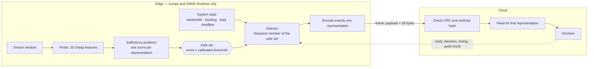
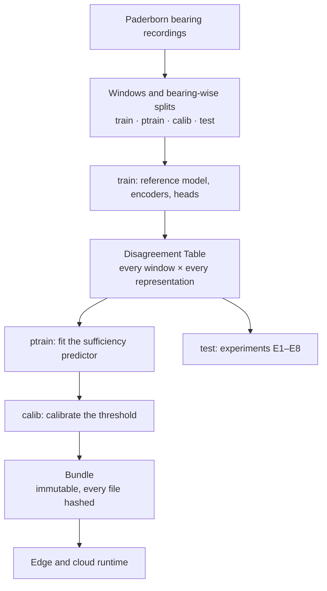
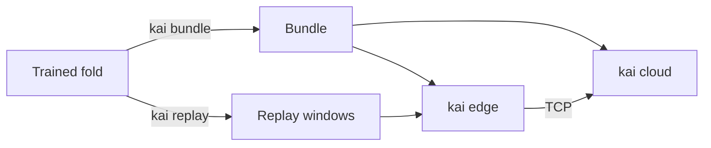

# Kai

**Sufficiency-certified representation selection for edge–cloud industrial IoT.**

An edge node has to decide, for every sensor window, *what* to send: raw samples, a compressed
waveform, engineered features, or a learned latent. Kai makes that a two-step decision:

1. **Certify** — score how likely each representation is to make the cloud disagree with the
   decision it would have made from raw data, and keep only a **safe set** calibrated so that
   `E[disagreement with the raw decision] ≤ α`.
2. **Optimize** — let any cost-aware policy pick the cheapest representation **inside that set**
   for the current bandwidth, backlog, edge load and deadline.

The guarantee holds for every member of the safe set, so the optimizer can be swapped without
re-proving anything. [PRD.md](PRD.md) is the full specification.

## How it works



Everything the edge needs comes from one offline pipeline:



No bearing appears in two partitions, so the models, the predictor, the calibration and the
evaluation each see different physical machines.

## Status

First implementation pass. Results are in [docs/research/results.md](docs/research/results.md),
generated by `make report` and never edited by hand.

| | |
|---|---|
| **Built and tested** | Representations R0–R7 · certificate variants V0 / V1 / V2 · ACI and drift monitor · selectors S0 / S1 / S2 and the oracle · baselines B1–B5 and B8–B11 · discrete-event simulator · edge and cloud runtime over real sockets · Docker closed loop with `tc netem` · experiments E1–E8 |
| **Ready, not yet run** | Raspberry Pi edge (`scripts/pi_setup.sh`) |
| **Not built** | R8 (JEPA), R9 (MiniRocket), bandit and RL selectors, escalation, privacy probe, transfer dataset, the paper |
| **Modelled, not measured** | All energy numbers · the "slow edge" sensitivity run · the 3G / 4G / 5G traces (synthetic) |

## What the first results say

Five leave-bearings-out folds of the Paderborn 3-class task. The hypotheses were fixed before the
experiments ([docs/research/hypotheses.md](docs/research/hypotheses.md)); six of the seven were
**not** supported, and they are reported as such.

| | Result | Verdict |
|---|---|---|
| Reference model | macro-F1 0.47 on unseen bearings (majority baseline 0.18; fold range 0.29–0.59) | gate met, narrowly |
| **H2** certificate holds on new bearings | risk 0.067 at α = 0.05, within α in 3 of 5 folds. On the *same* bearings it is 0.052 — the method is right when its premise holds; new bearings break the premise | not supported |
| Savings inside the safe set | cheapest certified payload is 35 % / 24 % / 18 % of raw at α = 0.02 / 0.05 / 0.10 | — |
| **H1** several representations matter | under byte pricing the oracle picks one (the 16-byte bottleneck) everywhere | not supported |
| **H3** Kai beats the best single representation | cost −10 % (CI −13 % … +34 %; target −20 %). About −40 % with 1 or 8 sensors per node, **+23 %** with 32, where the probe and predictor saturate the edge CPU | not supported |
| **H4** encode cost changes the choice | 4 % of loaded cells on laptop timings (target 15 %) | not supported |
| **H5** a mixed menu beats one family | cost −14 % against the best single family (target −10 %) | **supported** |
| **H6** closed-form break-evens match | no testable boundary: the compact representations are both smallest and fastest | not supported |
| **H7** simulator matches the real runtime | same representation chosen for 100 % of windows; p50 latency off by up to 16 % (loopback) and 19 % (Docker) against a 10 % target | not supported |

Read [docs/theory/limitations.md](docs/theory/limitations.md) before quoting any of this. The
weakest point is the reference model's accuracy across bearings: the certificate controls agreement
with that model, not its correctness.

## Quick start

```bash
scripts/bootstrap.sh                  # uv, Python 3.12, locked environment with CPU torch, checks
KAI_TORCH=gpu scripts/bootstrap.sh    # the same with the CUDA 13.0 build of torch
make check                            # lint, types, import contracts, tests with coverage gates
make mini-paper                       # the whole pipeline on a synthetic dataset, about 5 minutes
```

The CPU and GPU builds of torch are separate, mutually exclusive extras
(`uv sync --extra lab --extra cpu` or `--extra gpu`). The edge never needs either.

## Reproduce the results

```bash
make data               # download 29 Paderborn archives (about 5 GB) and build the windows and splits
make folds FOLDS=5      # train per fold and build the Disagreement Table (about 15 min per fold on a laptop GPU)
make paper-artifacts    # experiments E1–E8, figures, docs/research/results.md
```

`KAI_WORK=/some/dir` moves `data/`, `artifacts/` and `experiments/` elsewhere. A single experiment
takes Hydra overrides: `uv run --no-sync kai exp e3 scenario=mini profile=battery_node`.

## Run the edge and the cloud



| Where | Command |
|---|---|
| One machine | `kai cloud <bundle>` in one terminal, `kai edge <bundle> <replay.npz> --shape-bps 1e6` in another |
| Docker, kernel-shaped link | `make docker-loop FOLD=<fold dir> BUNDLE=artifacts/bundles/<id>` — runs at 256 kbit/s, 1 Mbit/s and 5 Mbit/s and compares each run with the simulator |
| Raspberry Pi | `scripts/pi_setup.sh` on the Pi (edge-only install, no torch), then `kai edge` against a `kai cloud` on another machine. Re-run `kai exp e1` on the Pi first: the shipped timings are from a laptop |

## Repository map

| Path | Contents |
|---|---|
| `src/kai/contracts` | representation protocol, wire frame, schemas |
| `src/kai/data`, `reps`, `tasks` | dataset and splits · representations R0–R7 · models, heads and the fold pipeline |
| `src/kai/certify`, `select` | probe, predictor, calibration, ACI, drift · cost model, ladder, selectors, baselines |
| `src/kai/link`, `edge`, `cloud` | simulator and traces · edge runtime · cloud server |
| `src/kai/profile`, `bench`, `analysis` | timing harness · experiments and registry · regime theory, statistics, figures |
| `tests/` | unit, property, integration, end-to-end and the synthetic mini-paper |
| `configs/` | Hydra: dataset, price presets, scenario grids |
| `docker/`, `scripts/` | images and shaping · data download, environment check, report |

## Documentation

| | |
|---|---|
| [docs/architecture.md](docs/architecture.md) | planes, packages, wire protocol, how to add a representation |
| [docs/glossary.md](docs/glossary.md) | the vocabulary, used the same way everywhere |
| [docs/theory/](docs/theory/) | Proposition 1 with its proof · regime theory · limitations of the guarantee |
| [docs/adr/](docs/adr/) | decisions and why, including every departure from the PRD |
| [docs/research/](docs/research/) | pre-registered hypotheses · results · novelty log |
| [worksplit.md](worksplit.md) | what each role does next, ranked by what the results showed |
| [CONTRIBUTING.md](CONTRIBUTING.md) | quality gates and the rules that are not negotiable |

## Data and licence

The Paderborn bearing data comes from the KAt-DataCenter (Lessmeier et al., PHME 2016). Its download
page states no licence; it is used here for research only and is never committed or redistributed.
This repository has **no licence file yet**: the project owner has to choose one.
