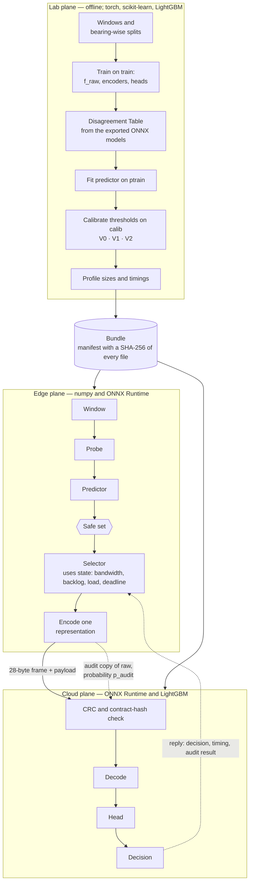

# Architecture

Three planes, one codebase (PRD §5). The edge never imports torch.

Partitions never share a bearing: `train` fits the models, `ptrain` the sufficiency predictor,
`calib` the thresholds, and `test` is only used by the experiments.

## Packages (`src/kai`)

| Package | What it holds | May be imported by the edge |
|---|---|---|
| `contracts` | `Representation` protocol, wire frame, `WindowSet`, pydantic schemas (splits, bundle manifest, profiles, run record) | yes |
| `data` | Paderborn loader, synthetic fixture, bearing-wise splitters | no (scipy) |
| `reps` | `classical` (R0–R4), `latent` (R5–R7 at run time), `features`, `registry` | yes |
| `tasks` | torch models, training, heads, the fold pipeline that builds the Disagreement Table | no |
| `certify` | `probe`, `predictor`, `crc`, `ltt`, `aci`, `drift`, `runtime` (edge-safe); `fit` (lab) | all but `fit` |
| `select` | cost model, ladder, S0/S1/S2/oracle, baselines B4–B11 | yes |
| `link` | asyncio framing, traces, bandwidth estimator, discrete-event simulator | yes |
| `edge` | bundle loader with integrity checks, runtime loop | — |
| `cloud` | head zoo, asyncio server | no |
| `profile` | timing harness with co-tenant load | no |
| `bench` | Hydra config, calibration, bundle builder, scenario cells, experiments E1–E8, run registry | no |
| `analysis` | regime theory, statistics, figures | no |

`import-linter` enforces two contracts: `contracts` imports nothing else from `kai`, and neither
`kai.edge` nor `kai.contracts` can reach torch, scikit-learn, pandas, scipy or LightGBM.

## Data flow between roles (PRD §14.1)

| Artifact | Type | Producer → consumer |
|---|---|---|
| Windows and metadata | `kai.contracts.windows.WindowSet` (`data/processed/*.npz`) | data → all |
| Split manifest | `SplitManifest` JSON in `data/splits/` (committed, hashed id) | data → all |
| Disagreement Table | `kai.tasks.pipeline.Table` (`table.npz`, long form in `disagreement.parquet`) | learning → certify, bench |
| Profiles | `RepProfile` list (`artifacts/profiles/local.json`) | systems → certify, bench |
| Calibration bundle | `artifacts/bundles/<id>/` (`BundleManifest`) | certify → edge, cloud |
| Run registry | `experiments/registry.parquet` (`RunRecord`) | all → evaluation |

## Wire protocol

`magic(2) | proto_ver(1) | rep_id(1) | contract_hash(4) | window_id(4) | ts_ns(8) | len(4) |
payload | crc32(4)` — 28 bytes of overhead for every representation, charged in every byte count.

The cloud looks the head up by `contract_hash`. An unknown hash is answered with `NEEDS_BUNDLE`
and the edge stops. The edge refuses to load a bundle if any file hash, the bundle id, a contract
hash or (when given) the lockfile hash differs from the manifest.

## Three execution backends

1. **Discrete-event simulator** (`kai.link.des`, SimPy): edge CPU and uplink as two FIFO stages,
   time-varying rate, store-and-forward buffer, audits. Used for the scenario grid.
2. **Real sockets** on one machine (`kai.bench.realrun`): cloud server subprocess, edge runtime with
   token-bucket pacing. `docker/compose.yaml` runs the same two programs in containers with
   kernel-level `tc` shaping and cgroup CPU limits.
3. **Raspberry Pi edge** (`scripts/pi_setup.sh`): the same edge runtime with the edge-only install.
   Prepared, not yet run.

## Adding a representation

1. Implement `encode` / `decode_for_head` / `codec_params` on a `BaseRep` subclass in `kai.reps`
   (numpy, pywt, zstandard or onnxruntime only).
2. Give it a code in `kai.contracts.representation.REP_CODES` and a place in
   `kai.reps.registry.MENU_ORDER`; build it in `classical_menu` or `_build`.
3. Add it to the codec-law tests in `tests/property/test_codecs.py`.

Everything downstream — table, predictor, calibration, selectors, simulator, runtime — is
menu-agnostic and picks the new column up.
