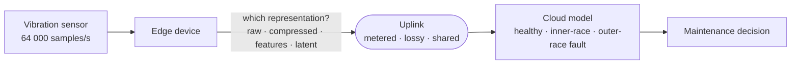
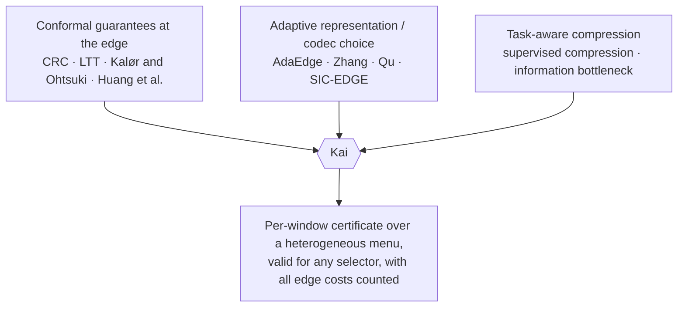
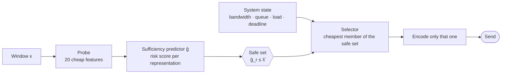
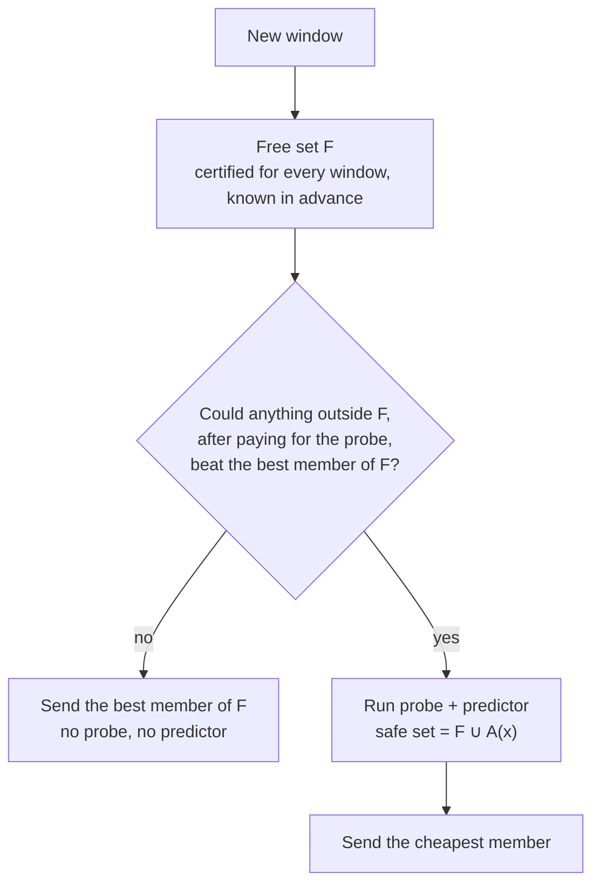
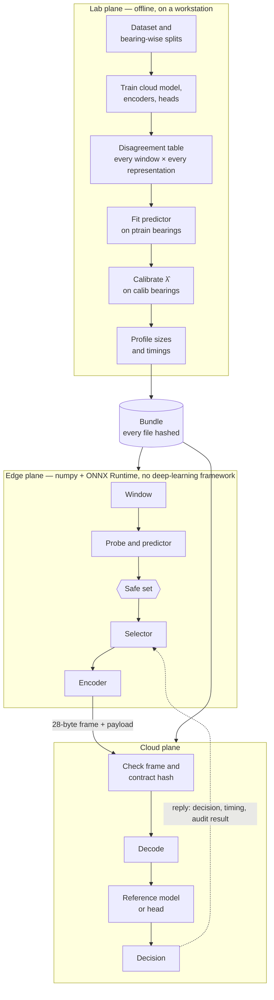
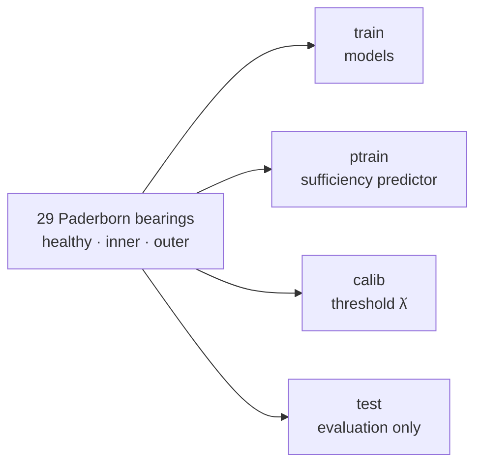
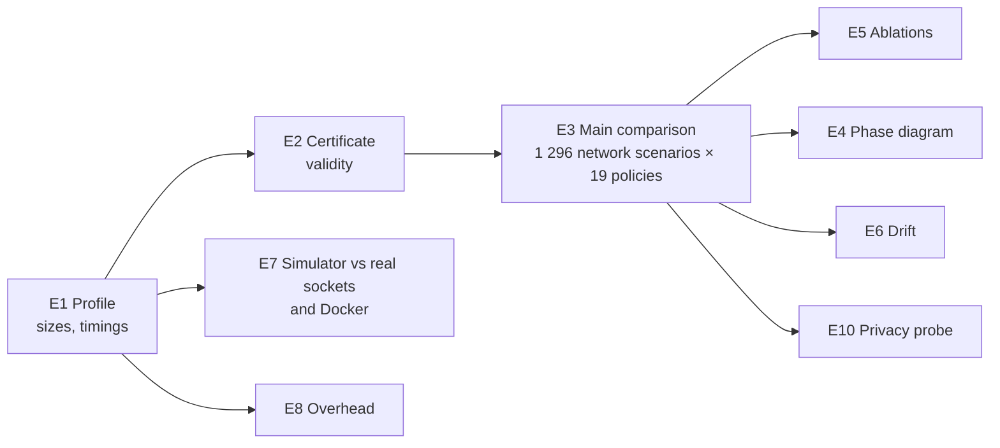
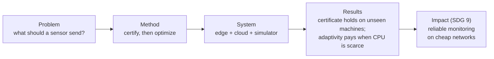

# Kai — Certified Data Offloading for Industrial Machine Monitoring

**Sufficiency-certified representation selection for edge–cloud industrial IoT**

> **SDG 9 — Industry, Innovation and Infrastructure.** Kai helps factories monitor machines over
> cheap, unreliable networks without losing diagnostic quality, and proves how much quality can be
> lost.

---

## 1. Introduction

Industrial machines (motors, pumps, gearboxes) carry vibration sensors that sample tens of thousands
of times per second. A small **edge device** next to the machine collects the signal and sends it
to a **cloud** server, where a model diagnoses faults such as a damaged bearing.

Sending the raw signal is expensive. One 64 ms window of one sensor is 8 KB, and a plant has
thousands of sensors on metered cellular links, battery nodes and congested gateways. So the edge
can send a smaller *representation* instead:

| Option | What is sent | Size |
|---|---|---|
| Raw | every sample | 8 192 B |
| Lossless compression | the same samples, compressed | ≈ 5 400 B |
| Wavelet compression | an approximate waveform | ≈ 2 200–4 200 B |
| Engineered features | spectral and statistical numbers | 24–128 B |
| Learned latent | a code from a small neural encoder | 16–32 B |

Smaller payloads save bandwidth, energy and money, but a payload that is too small may change the
cloud's diagnosis. **Kai decides, for every window, which representation to send, and gives a
statistical guarantee on how often that choice changes the diagnosis.**

---

## 2. Problem statement

> *For every sensor window, choose the cheapest representation to send — given the current
> bandwidth, queue, CPU load and deadline — such that the cloud's decision agrees with the decision
> it would have made from the raw data, with a guaranteed error rate of at most α.*

Today's systems either always send the same thing (wasteful or risky) or adapt heuristically with
no guarantee. Three gaps follow:

1. **No guarantee.** Adaptive compression is best effort; nobody can say how often it is wrong.
2. **Hidden costs.** Deciding takes edge CPU time too: computing features, running a predictor and
   encoding. Most work ignores this.
3. **Leaky evaluation.** Many papers on bearing data report about 95 % accuracy by testing on
   windows of the same machines they trained on. On machines the model has never seen, accuracy
   falls to about 50–60 %.

---

## 3. Definitions

| Term | Meaning |
|---|---|
| **Window** | 4 096 consecutive samples (64 ms) of one vibration channel |
| **Representation** | A payload format: an edge encoder plus a cloud decoder or head |
| **Reference model `f_raw`** | The cloud model that diagnoses from the raw window; its decision is the reference |
| **Decision agreement** | The cloud's decision from a representation equals its decision from raw. This is *not* the same as accuracy |
| **Sufficiency predictor ĝ** | A small edge model estimating, per representation, the chance that it would change the decision |
| **Safe set** | The representations certified for this window: `{raw} ∪ {r : ĝ_r ≤ λ̂}` |
| **Risk α** | The allowed rate of changed decisions, e.g. α = 0.05 (5 %) |
| **Calibration** | Choosing the threshold λ̂ on held-out machines so that the risk stays ≤ α |
| **Conformal risk control (CRC)** | The statistical method that gives the guarantee without assumptions on the model |
| **Leave-bearings-out** | The machines used for testing never appear in training |

---

## 4. Literature review

### 4.1 What each paper contributes, and how Kai differs

| # | Work | What it does | How Kai uses it or differs |
|---|---|---|---|
| 1 | **Angelopoulos, Bates, Fisch, Lei, Schuster** — *Conformal Risk Control*, ICLR 2024 | Distribution-free control of the expected value of a monotone loss | **Core theory.** Kai's certificate (V0) is CRC applied to the loss "some member of the safe set changes the decision" |
| 2 | **Angelopoulos, Bates, Candès, Jordan, Lei** — *Learn then Test* (2021) | Risk control with high probability, by multiple testing | Kai's second variant (V1) |
| 3 | **Gibbs & Candès** — *Adaptive Conformal Inference* (NeurIPS 2021) | Keeps coverage near the target when the data drift | Kai's audit-in-the-loop threshold for operating-condition shift |
| 4 | **Kalør & Ohtsuki 2025** — *Black-Box Edge AI Model Selection with Conformal Latency and Accuracy Guarantees* (arXiv 2506.11391) | Picks an encoder/model pair with conformal guarantees, from channel statistics | **Closest prior art.** They choose once, a priori, and control prediction-set coverage; Kai chooses per window and controls agreement with the raw decision. Re-implemented as baseline B11 |
| 5 | **Huang, Park, Paoletti, Simeone 2025** — *Reliable Inference in Edge-Cloud Model Cascades via Conformal Alignment* (arXiv 2510.17543) | Decides when the edge should hand over to the cloud model | They decide *whether* to offload; Kai decides *what data* to send |
| 6 | **Liu, Paparrizos, Elmore** — *AdaEdge*, ICDE 2024 | Picks per segment among 11 time-series codecs by agreement with the model on raw data, with a bandit | Same goal and signal, **but best effort, no guarantee**. Re-implemented as baseline B13 |
| 7 | **Zhang et al. 2023** (adaptive IoT data reduction) | Raises compression when the signal is steady, lowers it on drift | One codec family, no task guarantee. Baseline B9 |
| 8 | **Qu et al. 2026** (semantic / traditional switching) | Switches between two transmission modes on bandwidth | Two modes, no guarantee. Baseline B10 |
| 9 | **Amiri et al. 2022** (SIC-EDGE) | Sends wavelet layers progressively until enough | One hierarchy, no heterogeneous menu |
| 10 | **Matsubara et al. 2022; Shao & Zhang 2020** (supervised compression / split computing) | Train a compact encoder for a downstream task | Source of Kai's task-aware 16-byte latent (R6); they design encoders, Kai selects at run time |
| 11 | **Chen et al., Li et al., Zheng et al., Lyu, Xie** (semantic offloading, information bottleneck, 2023–2026) | Adapt one learned compression to the channel | Each has a single family; Kai certifies a choice across heterogeneous families |
| 12 | **Lessmeier et al.** — Paderborn bearing dataset, PHME 2016 | 32 bearings, artificial and real damage, 4 operating conditions | **Main dataset**; its geometry gives the fault frequencies Kai's models use |
| 13 | **Hong, Thuan et al.** — HUST bearing dataset (Mendeley Data, 2023) | 5 bearing types, several fault types, 3 loads | **Transfer dataset**, to check that results carry over |
| 14 | **Vieira et al. 2025** (arXiv 2509.22267); **Knap et al.**, PHME 2026; **Perminov & Korzun** | Show that random-window splits inflate bearing-fault accuracy to 99–100 %; bearing-wise results are 0.33–0.75 | Why Kai evaluates leave-bearings-out only |
| 15 | **Raca et al.** — *Beyond Throughput: a 4G LTE Dataset*, ACM MMSys 2018 | Measured 4G throughput logs | Real network variability in Kai's simulator |
| 16 | Adaptive-bitrate video streaming (MPC-based ABR) | Picks a video quality per chunk from bandwidth and buffer estimates | Inspiration for Kai's model-predictive selector and its bandwidth estimator |

### 4.2 The gap

Each of these pieces exists separately. Kai's contribution is to combine them into one certificate
over a heterogeneous menu, chosen per window, that stays valid whatever optimizer picks inside it.

---

## 5. Objectives

1. Make the representation a **per-window runtime decision** across 8+ families.
2. Provide a **statistical certificate**: changed decisions ≤ α on machines never seen before.
3. Count **every cost**: probe, predictor, encoder, queueing, transmission, decoding, energy.
4. Give a **regime theory**: when does each representation win?
5. Ship a **reproducible system**: one-command setup, tests, real network emulation.

---

## 6. How it works

### 6.1 Certify, then optimize

- **Step 1, certify.** The safe set holds every representation whose predicted risk is below the
  calibrated threshold λ̂. Raw is always in it.
- **Step 2, optimize.** Any cost-aware policy picks inside the safe set.
- **Guarantee (Proposition 1).** For *any* policy that picks inside the safe set, the expected rate
  of changed decisions is at most α. The optimizer can be replaced without re-proving anything.

### 6.2 Why the guarantee holds, in one line

Each calibration window is reduced to the smallest threshold at which it would cause a changed
decision. CRC picks λ̂ so that, counting one extra unseen window, at most an α share of windows
would be harmed. Whatever a policy picks inside the safe set can only be harmed when the worst
member is, so the bound carries over to every policy.

### 6.3 The cascade selector (the improved runtime)

Running the probe and predictor costs about 2.3 ms per window. The cascade avoids that cost when it
cannot change the outcome:

The fixed set `F` and the per-window set `A(x)` are each certified at α/2. By the union bound their
combination is certified at α, for any policy.

### 6.4 The degradation ladder

When nothing safe meets the deadline, the system follows a fixed rule instead of guessing:

1. a safe and feasible representation → send it (*certified*);
2. none, and fidelity matters most → store raw and send it later (*deferred*);
3. none, and liveness matters most → send the cheapest feasible one, flagged *uncertified*.

---

## 7. Architecture

### 7.1 Three planes

### 7.2 Which model runs where

| | Edge | Cloud |
|---|---|---|
| Job | decide **what to send** | decide **what is wrong with the machine** |
| Models | sufficiency predictor (tiny networks); learned encoders | reference model (EnvNet); one small head per compact representation |
| Software | numpy, ONNX Runtime | ONNX Runtime, LightGBM |

### 7.3 The representation menu

| ID | Family | Size | Cloud side |
|---|---|---|---|
| R0 | Raw | 8 192 B | reference model |
| R1 | Lossless (delta + byte shuffle + zstd) | ≈ 5 400 B | reference model |
| R2a / R2b | Wavelet, 1 % / 5 % error | ≈ 4 200 / 2 200 B | reference model |
| R3 | Envelope and spectral features | 128 B | head |
| R4 | Summary statistics | 24 B | head |
| R5 | Autoencoder latent | 32 B | head |
| R6 | Task-aware bottleneck latent | 16 B | head |
| R7 | Vector-quantised codes | 16 B | head |

---

## 8. Methodology

### 8.1 Data and leakage-safe splits

No bearing appears in two partitions, and random-window splits are banned by a build check.
Fifteen folds (3 repeats × 5) and 3 training seeds. A second dataset (HUST) and leave-condition-out
folds test transfer and drift.

### 8.2 The cloud model

About 150 candidate models were tried and **every one is recorded**, losers included. They were
selected only by cross-validation on training bearings, never on test bearings. CNNs, MLPs and
bearing-adversarial training lost. The winner, **EnvNet**, is deliberately simple: the envelope
spectrum (how a fault's periodic impacts modulate the vibration) divided by its own median, then a
logistic regression.

### 8.3 Pre-registered hypotheses

| | Hypothesis |
|---|---|
| H1 | Several representations are needed (no single one is close to the oracle) |
| H2 | The certificate holds on unseen bearings |
| H3 | Kai is cheaper than the best single representation, and more reliable than a context-blind selector |
| H4 | Accounting for encode cost changes choices under load |
| H5 | A mixed menu beats the best single family |
| H6 | Closed-form break-even bandwidths match measurements |
| H7 | The simulator matches the real runtime |

The thresholds were fixed before any experiment. A hypothesis counts as *supported* only if its
threshold is met **and** it survives a Holm-corrected test across all eight. Failed hypotheses
stay failed.

### 8.4 Experiments

Baselines: always raw (B1), fixed compression (B2), fixed features (B3), best single representation
(B4), context-blind (B5), oracle (B7), lookup table (B8), and re-implementations of Zhang (B9), Qu
(B10), Kalør & Ohtsuki (B11) and AdaEdge (B13).

---

## 9. Implementation

| Area | What was built |
|---|---|
| Edge runtime | asyncio client, select-then-encode, store-and-forward, audit sampling, no deep-learning framework on the device |
| Cloud server | asyncio server, hash-checked bundles, error replies for bad payloads |
| Simulator | discrete-event model of the edge CPU and uplink queue, with synthetic and measured 4G traces |
| Real network | loopback sockets and Docker containers with Linux `tc netem` shaping |
| Quality | about 135 tests (property-based, integration, end-to-end), type checking, import-boundary checks, two code audits and an automated review of the proof |
| Reproducibility | locked environment, hashed run registry, one command regenerates every number in the report |

---

## 10. Results

### 10.1 The cloud model, on machines it has never seen

| Model | Macro-F1 |
|---|---|
| Majority class | 0.18 |
| First model (spectral shape) | 0.47 |
| **EnvNet (final)** | **0.60** (15 folds) |
| EnvNet on the second dataset (HUST) | 0.64 |
| The same features evaluated the leaky way | 0.95 |

Published bearing-wise results on this dataset lie between 0.33 and 0.75.

### 10.2 The certificate (α = 0.05, 15 folds)

| Certificate | Changed decisions | Folds within α | Smallest certified payload |
|---|---|---|---|
| Per-window (V0) | 3.9 % | 12 / 15 | 13.6 % of raw |
| Static safe set | 3.0 % | 15 / 15 | 0.2 % of raw |
| **Cascade** | **1.9 %** | **15 / 15** | **0.2 % of raw** |

### 10.3 The system

| Finding | Number |
|---|---|
| Static safe set vs best single representation, bytes priced | 1.4 × the cost, fewer missed deadlines |
| Cascade vs per-window selector, bytes priced | about 40 % cheaper; the probe runs on 12 % of windows |
| Per-window selection when **edge CPU time** is priced | **73 % cheaper** than any single representation (5 folds, exploratory) |
| Missed deadlines vs a context-blind selector, bursty links | 30 % fewer |
| Queue awareness | ignoring the uplink queue costs 29 % more |
| Simulator vs real runtime | same choice for 100 % of windows; median latency within 10–17 % |
| Privacy | a 16-byte latent still identifies a known machine in 59 % of windows |

### 10.4 Hypothesis verdicts

None of H1–H7 is supported under the strict rule. H2 (the certificate holds) meets its threshold
but is not statistically significant with 15 folds. The failures are informative: with one
vibration channel and byte pricing, a single 16-byte representation is good enough almost
everywhere, so adaptive choice has little to gain. It pays when CPU time is the scarce resource.

---

## 11. Expected outcomes

| Outcome | Status |
|---|---|
| A certified, swappable decision layer for edge offloading | built and tested |
| A cascade runtime that pays for decision-making only when it helps | built; matches the best static policy in its certificate |
| A map of when adaptive choice pays (by price regime) | measured on one dataset; CPU-priced regime to be confirmed on 15 folds |
| An honest benchmark for bearing diagnosis on unseen machines | built, with every model candidate recorded |
| Validation on real edge hardware (Raspberry Pi) and measured energy | pending hardware |
| A paper: workshop or benchmark track now; main track after the next steps | in preparation |

---

## 12. Relevance to SDG 9

| SDG 9 target | Contribution |
|---|---|
| **9.1** Reliable, resilient infrastructure | Predictive maintenance keeps machines running; the certificate bounds how often compression could hide a fault |
| **9.4** Resource-efficient, clean technology | Sends as little as 0.2 % of the raw data when that is safe: less bandwidth, radio energy and cloud compute |
| **9.5** Research and technological capability | Open, reproducible benchmark with an honest evaluation protocol |
| **9.c** Access to communication technology | Works on low-bandwidth, metered and intermittent links, where industrial IoT is hardest to deploy |

---

## 13. Limitations

- The certificate controls agreement with the cloud model, not its correctness; that model is right
  about six times in ten on unseen machines.
- Few physical machines: 5 calibration bearings per fold. A machine-level guarantee would need
  about 19.
- The 16-byte latent runs the cloud model's feature extraction on the edge.
- Timings come from a laptop; energy is modelled; the 4G traces are measured downlink logs, rescaled.
- The certificate does not survive a change of operating condition; the audit loop is the remedy.

---

## 14. Future work

1. Raspberry Pi runs and measured energy.
2. Confirm the CPU-priced advantage on all 15 folds.
3. Longer windows (256 ms) with a bearing-physics model (0.64 in cross-validation).
4. Datasets with many more machines, for machine-level guarantees.
5. Multi-sensor and multi-task settings, where representations genuinely trade off.

---

## 15. Summary

**One sentence:** Kai lets an industrial sensor send as little data as possible, adapt to the
network in real time, and prove how rarely that changes the diagnosis.
