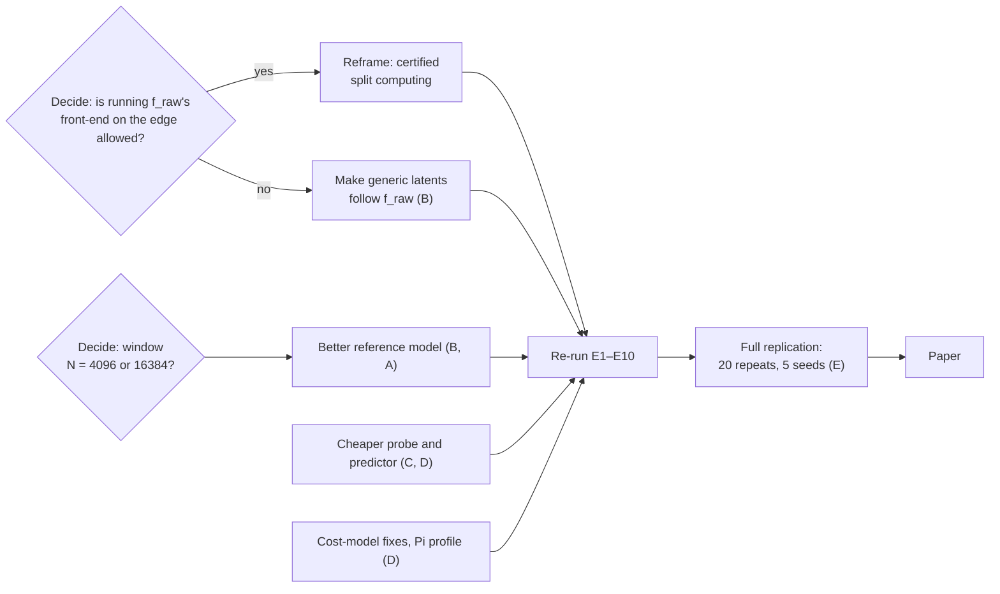

# Work split — what to do next

Status on 15 Oct 2026: three passes are done. The first built the pipeline end to end; the second
replaced the reference model, re-ran every experiment and reviewed the certificate. Results are in
[docs/research/results.md](docs/research/results.md). This file turns them into work, by role
(roles A–E as in [PRD.md](PRD.md) §14).

## Start here (everyone, first day)

```bash
scripts/bootstrap.sh        # uv, Python 3.12, locked environment; add KAI_TORCH=gpu for CUDA
make check                  # must be green before you change anything
make mini-paper             # the whole pipeline on synthetic data, about 5 minutes
```

Then read, in this order: [README.md](README.md) → [docs/research/results.md](docs/research/results.md)
→ [docs/theory/limitations.md](docs/theory/limitations.md) →
[ADR 0006](docs/adr/0006-envelope-reference-model.md) (the reference model and R6) →
[ADR 0007](docs/adr/0007-certificate-review.md) (what the review of the certificate found).
Nothing in this repository has been reviewed by a second person yet. Review as you read.

## Where things stand (15 Oct 2026)

| Area | Status |
|---|---|
| Reference model | EnvNet, macro-F1 0.60 on unseen bearings over 15 folds (0.64 on HUST) |
| Certificate | per-window V0 below α on average but not significantly; the **certified static safe set** is within α in every Paderborn fold |
| System | per-window selection loses to best-single under byte pricing (3.4×) and wins when edge CPU is priced (73 % cheaper, exploratory) |
| Code | two audits, all findings fixed or recorded (ADR 0010); `make check` green |
| Replication | 3 repeats × 5 folds; seeds 0–2 on repeat 0 |
| Not done here | Raspberry Pi, measured energy, human review of Proposition 1, CI on GitHub, DVC remote |

## The problems the results point at now

| # | Problem | Evidence | Owner |
|---|---|---|---|
| 1 | Selection between representations hardly matters any more | One 16-byte representation agrees with the reference model in 99.3 % of windows; the generic compact ones (R3, R4, R5, R7) disagree in 36–52 % | everyone — this is the paper's central question |
| 2 | The reference model is still weak, and a longer window would help | 0.61 at 64 ms; fault-order features reach 0.64 in inner CV at 256 ms; the 900 rpm condition scores 0.44 against 0.60 | B, A |
| 3 | The per-window overhead is larger than any encoder | probe + predictor + selector = 2.3 ms, 3.4 × the cheapest encoder | C, D |
| 4 | The simulator's cost model misses real effects | p50 latency off by up to 10.1 % on loopback (target 10 %); measured latency 41 % above the model at edge load 0.8 | D |
| 5 | Too little replication | 5 folds × 1 repeat × 1 seed (plan: 5 × 20 × 5); Holm over eight hypotheses needs more folds to reject anything | E |



## Role A — Data and classical representations

| Priority | Task | Done when |
|---|---|---|
| P0 | Confirm the Paderborn licence and terms of use; record them in `README.md` | A sentence with a source replaces "states no licence" |
| P0 | Set up the DVC remote and publish `data/processed/` so nobody else downloads 5 GB | `dvc pull` gives a teammate `pu.npz` |
| P1 | Window length. The search measured it by joining windows ([ADR 0006](docs/adr/0006-envelope-reference-model.md)): 0.56 → 0.64 for fault-order features at N = 16 384, no gain for EnvNet's front-end. Build the real N = 16 384 dataset and scenario grid if the group decides to switch | `pu.npz` at the new N, scenarios re-scaled, E1 re-run |
| P1 | Rebuild with all 20 recordings per bearing (`scripts/prepare_pu.py --n-measurements 20`); only 5 are used now | New `pu.npz`, split manifests unchanged |
| P1 | Choose the transfer dataset by the checklist in PRD §8.1 and write its loader | A `WindowSet` from a second dataset; cross-dataset experiment runs |
| P2 | Redesign R3 so that engineered features can follow EnvNet (it disagrees in 36 % of windows): per-band envelope-spectrum ratios instead of band energies | R3 disagreement below 10 % in inner CV, codec-law tests green |
| P2 | R9 (MiniRocket-style features); the `lz4` variant of R1 | Passes the codec-law tests in `tests/property/test_codecs.py` |

Code: `src/kai/data/`, `src/kai/reps/classical.py`, `scripts/prepare_pu.py`.

## Role B — Learning

| Priority | Task | Done when |
|---|---|---|
| **P0** | **Generic latents that follow the reference model.** A CNN bottleneck trained on 11–14 bearings disagrees with EnvNet in 46–49 % of windows on new bearings, with hard or soft targets and with relabelled augmentation (stage D of [model-search.md](docs/research/model-search.md)). Either find a recipe that works without the teacher's front-end, or show it cannot be done at this data size | R5 / R7 / generic R6 below 10 % disagreement in inner CV, or a negative result in an ADR |
| P0 | Push the reference model further, selecting only by inner CV on training bearings (`scripts/model_search.py`). Leads the search left open: the multi-label formulation with the three combined-damage bearings; a speed-aware model for the 900 rpm condition; more training bearings per fold | Mean test macro-F1 ≥ 0.65 and worst fold ≥ 0.50, recorded in a new ADR |
| P1 | Train ≥ 5 seeds per fold (`kai folds --seed k`) | Seed variance reported next to fold variance |
| P2 | JEPA (R8) go / no-go, time-boxed to one week | A decision in an ADR |

Code: `src/kai/tasks/` (`models.py`, `train.py`, `heads.py`, `pipeline.py`), `src/kai/reps/latent.py`,
`scripts/model_search.py`.

## Role C — Certification and decision

| Priority | Task | Done when |
|---|---|---|
| **P0** | Have a person other than the author check [docs/theory/proposition1.md](docs/theory/proposition1.md) line by line; the automated review's corrections are in it | Reviewer's name and date in the file |
| P0 | Finish the review's open items ([ADR 0007](docs/adr/0007-certificate-review.md)): key the predictor cache on the `ptrain` bearings; stop `no_certificate` / `audit_aci` decisions carrying the `certified` flag; decide whether E3's V1 row is single-threshold or per-representation | Each closed with a test |
| P0 | The certificate under bearing shift. V0 now misses by 0.0004 at α = 0.02 and 0.0015 at α = 0.05; a fold has five calibration bearings. Try calibration weighted by probe features, and report what a bearing-level certificate would need (≥ 19 calibration bearings at α = 0.05) | H2-style table for the new variant over ≥ 5 folds |
| P1 | Cut the per-window overhead: a time-statistics-only probe, or scoring every k-th window with a lag-calibrated threshold. Measure with `kai exp e1` and `e8` | Overhead below the cheapest encoder |
| P1 | The drift monitor fires on almost every test window without any condition shift: it detects that a bearing is new. Give it a per-machine reference | False-alarm rate below 5 % on L1 folds, detection kept on L2 |
| P2 | Bandit selector (S3); escalation across families (C6) | Runs in the simulator with tests |

Code: `src/kai/certify/`, `src/kai/select/`, `docs/theory/`.

## Role D — Systems and emulation

| Priority | Task | Done when |
|---|---|---|
| **P0** | **Raspberry Pi.** Run `scripts/pi_setup.sh`, then `kai exp e1` on the Pi for a real edge profile, and repeat the sim-to-real and overhead experiments with the Pi as the edge. R6's encoder is now a 258-kernel STFT: its cost on a Pi decides whether the 16-byte payload is realistic | Pi profile committed; results have a Pi section |
| P0 | Close the sim-to-real gap: about 1 ms of event-loop and socket time per window on loopback, TCP/IP header bytes at low rates in Docker | E7 and E7d p50 gap ≤ 10 % |
| P1 | Profile at the node's real duty cycle. Timings are taken at one window per 64 ms; a node with 32 sensors is never idle, so its caches are warm and the cold timings overstate its cost. Measure before changing the model | E1 reports timings at 64, 8 and 2 ms periods; E3 uses the matching one |
| P1 | Replace the load exponent with a capacity model. Fitted exponents are near 0, yet measured latency at load 0.8 is 41 % above the model | E4 model bias within ±10 % at both loads |
| P1 | Pin Docker base images by digest; build for `linux/arm64`; set the `performance` governor where possible | CI `edge-image` job green |
| P2 | Measured energy once a USB power meter is available; real cellular traces with E | Energy labelled *measured*; trace sources and licences in `configs/scenario/traces/README.md` |

Code: `src/kai/edge/`, `src/kai/cloud/`, `src/kai/link/`, `src/kai/profile/`, `docker/`, `scripts/`.

## Role E — Evaluation, reproducibility and paper

| Priority | Task | Done when |
|---|---|---|
| **P0** | Re-word the novelty claims after the first sweep ([novelty-log.md](docs/research/novelty-log.md)): AdaEdge (ICDE 2024) already selects per segment among lossless and lossy codecs on the edge and scores by agreement with the model on raw data; what remains for C1 is the per-window certificate and the any-selector statement. Correct the description of Kalør & Ohtsuki in PRD §3.3 | Claims in the PRD and the paper outline match the log |
| P0 | Turn CI on: push, enable branch protection, pin every action to a commit SHA, run `pre-commit autoupdate --freeze` | Green `ci` and `nightly` workflows |
| P1 | Run the main comparison under the other three price presets (`kai exp e3 profile=battery_node`, …). H1 was tested only under byte pricing | H1 reported per preset |
| P1 | After the decisions below: 20 repeats × 5 folds × 5 seeds, and the L2 folds. A fold takes about 10 minutes on a laptop GPU; do not run two fold trainings at once (LightGBM stalls) | Confidence intervals narrow enough for the Holm test to mean something |
| P1 | Add an "edge inference" baseline: the edge runs the whole reference model and sends the decision. With EnvNet this is one linear layer more than R6 does | A row in E3 |
| P2 | RL baseline (B12), the paper | — |

Code: `src/kai/bench/`, `src/kai/analysis/`, `scripts/report.py`, `.github/`.

## Decisions the group still has to make

| Decision | Why it matters |
|---|---|
| **May the edge run the reference model's front-end?** | R6 does, and that is why a 16-byte payload is certifiable. If yes, the paper is about *certified split computing* and must answer "why not classify on the edge?". If no, set `bottleneck: generic` in `configs/dataset/pu.yaml`: the menu then has no compact representation that follows EnvNet and the smallest certifiable payload is a 2 kB wavelet frame |
| **Window length N** | 4096 samples (64 ms) holds less than one shaft revolution at 900 rpm. N = 16 384 would lift fault-order models to about 0.64 in inner CV but changes the raw payload, the window period and every scenario |
| Who is A, B, C, D, E, and who backs up whom | `.github/CODEOWNERS` is a commented template until names exist |
| Licence | There is no licence file; nobody outside the team may reuse the code until one is chosen |
| Real deadline and target venue | The PRD's 16-week calendar is an assumption |
| Whether the 3-class task stays | Binary healthy-versus-damaged scores 0.73 on held-out bearings with the same front-end |
| Where raw data and the DVC remote live | Blocks task A-P0 |

## Rules while you work

- Hypotheses are frozen in [docs/research/hypotheses.md](docs/research/hypotheses.md). Changing a
  metric or a threshold needs an ADR dated **before** the result is seen. A failed hypothesis stays
  failed. A tested hypothesis is *supported* only if its threshold is met and the Holm test rejects.
- Splits are by bearing. `scripts/check_no_l0_splits.py` fails the build on random-window splits.
  Scores near 0.95 on this dataset come from such splits ([ADR 0006](docs/adr/0006-envelope-reference-model.md)).
- Models are selected by inner CV on training bearings only, and every candidate is recorded
  (`scripts/model_search.py`, [model-search.md](docs/research/model-search.md)).
- "Agreement with the raw model" is not "accuracy". Keep them apart in names, columns and plots.
- `make check` green and a second reviewer before merging; two reviewers for `contracts/` and
  `certify/`. Full rules: [CONTRIBUTING.md](CONTRIBUTING.md).
- Every result in the paper comes from `make report`, never from a number typed by hand.
