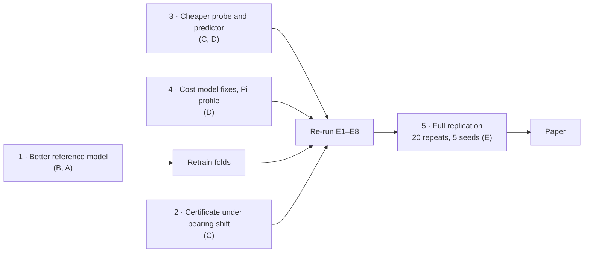

# Work split — what to do next

Status on 10 Oct 2026: the first implementation pass is finished. The pipeline runs end to end on
the Paderborn data, `make check` is green, and the first results are in
[docs/research/results.md](docs/research/results.md). Six of the seven pre-registered hypotheses
were **not** supported. This file turns those results into work, by role (roles A–E as in
[PRD.md](PRD.md) §14).

## Start here (everyone, first day)

```bash
scripts/bootstrap.sh        # uv, Python 3.12, locked environment; add KAI_TORCH=gpu for CUDA
make check                  # must be green before you change anything
make mini-paper             # the whole pipeline on synthetic data, about 5 minutes
```

Then read, in this order: [README.md](README.md) → [docs/research/results.md](docs/research/results.md)
→ [docs/theory/limitations.md](docs/theory/limitations.md) →
[docs/adr/0004-reference-model-and-heads.md](docs/adr/0004-reference-model-and-heads.md).
Nothing in this repository has been reviewed by a second person yet. Review as you read.

## The five problems the results point at

| # | Problem | Evidence | Owner |
|---|---|---|---|
| 1 | The reference model barely generalises across bearings | macro-F1 0.47 on unseen bearings, 0.29 in the worst fold | B (with A) |
| 2 | The certificate does not hold on new bearings | risk 0.067 at α = 0.05; 3 of 5 folds within α. On the *same* bearings: 0.052 | C |
| 3 | The per-window overhead is too high | probe + predictor + selector = 2.3 ms, more than any learned encoder; with 32 sensors Kai costs 23 % *more* than the best single representation | C (with D) |
| 4 | The simulator's cost model misses real effects | p50 latency off by 16–19 %; measured latency 35 % above the model at edge load 0.8 | D |
| 5 | Too little replication | 5 folds × 1 repeat × 1 seed (plan: 5 × 20 × 5); only 2 condition-shift folds | E |



Do problems 1–4 before spending compute on problem 5: every one of them changes the numbers.

## Role A — Data and classical representations

| Priority | Task | Done when |
|---|---|---|
| P0 | Confirm the Paderborn licence and terms of use; record them in `README.md` | A sentence with a source replaces "states no licence" |
| P0 | Set up the DVC remote and publish `data/processed/` so nobody else downloads 5 GB | `dvc pull` gives a teammate `pu.npz` |
| P1 | Rebuild with all 20 recordings per bearing (`scripts/prepare_pu.py --n-measurements 20`); only 5 are used now | New `pu.npz`, split manifests unchanged |
| P1 | Window-length study with B: 64 ms windows resolve only 15.6 Hz, too coarse for envelope analysis. Try N = 16 384 | A table of reference-model inner-CV macro-F1 against N, in an ADR |
| P1 | Choose the transfer dataset by the checklist in PRD §8.1 and write its loader | A `WindowSet` from a second dataset; cross-dataset experiment runs |
| P2 | R9 (MiniRocket-style features); the `lz4` variant of R1 | Passes the codec-law tests in `tests/property/test_codecs.py` |

Code: `src/kai/data/`, `src/kai/reps/classical.py`, `scripts/prepare_pu.py`.

## Role B — Learning

| Priority | Task | Done when |
|---|---|---|
| **P0** | **Improve the reference model.** Candidates, in the order the evidence suggests: longer windows; order-domain envelope features (scored 0.54 in inner CV but need the shaft speed, which the frame does not carry yet — agree a metadata field with D); the multi-label formulation the PRD mentions. Select only by inner CV on training bearings, as in ADR 0004 | Mean test macro-F1 ≥ 0.60 and worst fold ≥ 0.45, recorded in a new ADR |
| P1 | The learned latents are weak and unstable: R5 disagrees with the raw decision on 44 % of windows (sd 0.16), R7 on 40 % (sd 0.22). Removing them costs Kai only 1 % | Either they improve clearly or they are dropped with an ADR |
| P1 | Train ≥ 5 seeds per fold (`kai folds --seed k`) | Seed variance reported next to fold variance |
| P2 | JEPA (R8) go / no-go, time-boxed to one week; decoder-aware fine-tuning ablation | A decision in an ADR |

Code: `src/kai/tasks/` (`models.py`, `train.py`, `heads.py`, `pipeline.py`), `src/kai/reps/latent.py`.

## Role C — Certification and decision

| Priority | Task | Done when |
|---|---|---|
| **P0** | **The certificate under bearing shift.** Audit-in-the-loop ACI is the promising lead: under condition shift it brought risk from 0.125 to 0.054 for 19 % more bytes. Make it a first-class variant, run it over the whole grid, and study how the audit rate trades against risk. Also try calibration weighted by probe features (covariate shift) | H2-style table for the new variant over ≥ 5 folds |
| P0 | Have someone other than the author check [docs/theory/proposition1.md](docs/theory/proposition1.md) line by line (PRD §14.2) | Reviewer's name and date in the file |
| P1 | Cut the per-window overhead: a time-statistics-only probe (no FFT), the predictor as one matrix product, or scoring every k-th window. Measure with `kai exp e1` and `e8` | Overhead below the cheapest learned encoder |
| P1 | The drift monitor fires on 97 % of test windows without any condition shift: it detects that a bearing is new. Give it a per-machine reference | False-alarm rate below 5 % on L1 folds, detection kept on L2 |
| P1 | V1 per-representation thresholds stay within α in only 1 of 5 folds at α ≤ 0.05; MPC equals greedy under byte pricing. Evaluate both under the `wired_gateway` preset, where CPU time is priced | A paragraph in the results with numbers |
| P2 | Bandit selector (S3); escalation across families (C6) | Runs in the simulator with tests |

Code: `src/kai/certify/`, `src/kai/select/`, `docs/theory/`.

## Role D — Systems and emulation

| Priority | Task | Done when |
|---|---|---|
| **P0** | **Raspberry Pi.** Run `scripts/pi_setup.sh`, then `kai exp e1` on the Pi for a real edge profile, and repeat the sim-to-real and overhead experiments with the Pi as the edge | Pi profile committed; results have a Pi section |
| P0 | Close the sim-to-real gap: add TCP/IP header bytes (about 52 per packet) and about 1 ms of event-loop time to the cost model | E7 and E7d p50 gap ≤ 10 % |
| P1 | Replace the load exponent with a capacity model. Measured exponents are near 0, yet real latency at load 0.8 is 35 % above the model | E4 model bias within ±10 % at both loads |
| P1 | The 32-sensor case saturates one core. Batch the probe across sensors, or use more than one core | The 32-sensor cells stop dominating the cost |
| P1 | Pin Docker base images by digest; build for `linux/arm64`; set the `performance` governor where possible | CI `edge-image` job green |
| P2 | Measured energy once a USB power meter is available; real cellular traces with E | Energy labelled *measured*; trace sources and licences in `configs/scenario/traces/README.md` |

Code: `src/kai/edge/`, `src/kai/cloud/`, `src/kai/link/`, `src/kai/profile/`, `docker/`, `scripts/`.

## Role E — Evaluation, reproducibility and paper

| Priority | Task | Done when |
|---|---|---|
| P0 | Run the novelty sweep of PRD §19. None has been run since the PRD was written | Dated entry in `docs/research/novelty-log.md` |
| P0 | Turn CI on: push, enable branch protection, pin every action to a commit SHA, run `pre-commit autoupdate --freeze` | Green `ci` and `nightly` workflows |
| P1 | Run the main comparison under the other three price presets (`kai exp e3 profile=battery_node`, …). H1 (diversity) was tested only under byte pricing, where one representation always wins | H1 reported per preset |
| P1 | After problems 1–4: 20 repeats × 5 folds × 5 seeds, and at least 5 condition-shift (L2) folds. A fold takes about 15 minutes on a laptop GPU, so plan the compute | Confidence intervals narrow enough for the Holm test to mean something |
| P1 | Write the remaining baselines' re-implementation notes (`docs/research/baselines-repro.md`): B9–B11 are conceptual adaptations, not the authors' code | File exists and is cited in the results |
| P2 | RL baseline (B12), privacy probe (E10), the paper | — |

Code: `src/kai/bench/`, `src/kai/analysis/`, `scripts/report.py`, `.github/`.

## Decisions the group still has to make

| Decision | Why it matters |
|---|---|
| Who is A, B, C, D, E, and who backs up whom | `.github/CODEOWNERS` is a commented template until names exist |
| Licence | There is no licence file; nobody outside the team may reuse the code until one is chosen |
| Real deadline and target venue | The PRD's 16-week calendar is an assumption |
| Whether the 3-class task stays | If the reference model cannot be improved, binary healthy-versus-damaged is the honest fallback |
| Where raw data and the DVC remote live | Blocks task A-P0 |

## Rules while you work

- Hypotheses are frozen in [docs/research/hypotheses.md](docs/research/hypotheses.md). Changing a
  metric or a threshold needs an ADR dated **before** the result is seen. A failed hypothesis stays
  failed.
- Splits are by bearing. `scripts/check_no_l0_splits.py` fails the build on random-window splits.
- "Agreement with the raw model" is not "accuracy". Keep them apart in names, columns and plots.
- `make check` green and a second reviewer before merging; two reviewers for `contracts/` and
  `certify/`. Full rules: [CONTRIBUTING.md](CONTRIBUTING.md).
- Every result in the paper comes from `make report`, never from a number typed by hand.
